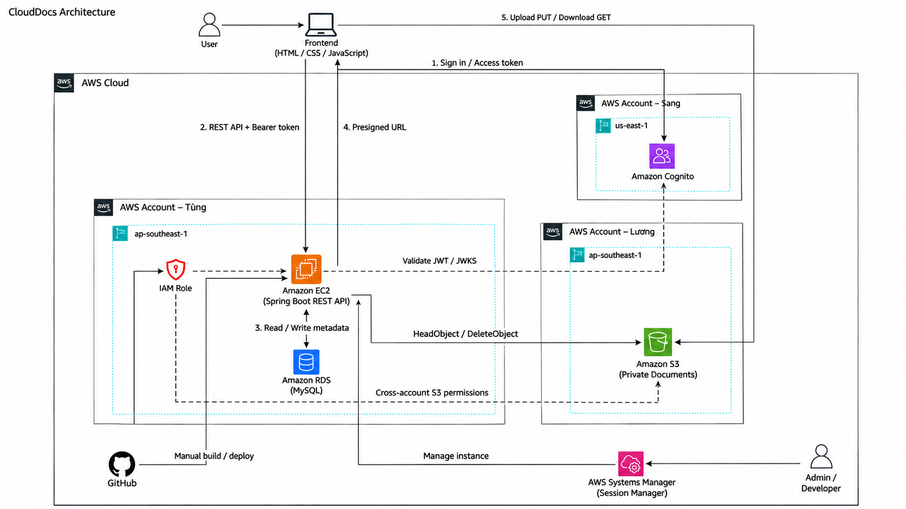

This section presents **CloudDocs — Enterprise document management on the AWS cloud**.

# CloudDocs — Enterprise document management on AWS
## A solution combining Spring Boot, MySQL, S3 and Cognito

### 1. Executive summary

CloudDocs centralizes documents and work-processing workflows in a web application. ADMIN manages accounts, documents and announcements; USER manages owned or shared documents. Java 21/Spring Boot 3.5.6 provides REST APIs and authorization; HTML/CSS/JavaScript provides the frontend; MySQL stores metadata, sharing relationships, quotas and business audit records. Files are stored in private S3, with authentication through a Cognito User Pool.

The target architecture uses EC2 for the application and Nginx, RDS MySQL for the database and an IAM role for S3 access. The application uses S3 for documents, Cognito for authentication and MySQL for business data.

### 2. Problem statement

*Current problems*

Documents scattered across personal devices or chat channels are difficult to find, authorize and trace to the person who changed them. Accidental deletion, excessive sharing, missing capacity controls and disconnected assignments and reports reduce traceability.

*Solution*

CloudDocs organizes documents by metadata and department and supports search/filtering, preview, download, permission-based sharing, favorites and trash. The backend checks permissions before issuing time-limited URLs; files move directly between the browser and S3. MySQL stores business data and audit records. Assignment creation, report submission, approval and change requests are extensions available in the early-November release.

*Benefits and return on investment (ROI)*

- Reduce manual searching and sharing; measure the time required for the same scenario before and after adoption.
- Separate file contents from metadata for clearer data management and fewer file transfers through the backend.
- Use trash and audit records to handle mistakes; apply account quotas to control allocations.
- Financial ROI and savings rates have not been measured. Costs are modeled from assumptions and compared with Billing during deployment.

### 3. Solution architecture

*AWS services used or planned for operation*

| Category | Component | Role and status |
| --- | --- | --- |
| Compute | Amazon EC2, Nginx | Application server environment; EC2 connectivity has been established |
| Database | Amazon RDS for MySQL | Metadata, users, permissions and audit; RDS MySQL connectivity has been established |
| Storage | Amazon S3 | Private bucket, signed PUT/GET and object confirmation; integrated in the code |
| Identity | Amazon Cognito User Pool | PKCE sign-in and access token issuance; integrated in the code |
| Security/network | IAM Role, VPC, Security Group | Resource permissions and network restrictions configured per environment |
| Operations | CloudWatch, Budgets | Resource monitoring, log collection and budget tracking |

*Component design*

- **Frontend:** static web interface; the Cognito public client has no client secret. Configure callback, logout and API_BASE for each environment.
- **Backend:** validate JWTs, read current roles/status from MySQL, check owner_id and document permissions, and manage upload state and quotas.
- **RDS/MySQL:** store users, documents, permissions, favorites, notifications, audit and work_tasks according to the current schema.
- **S3:** UUID object keys; original names remain in metadata. Workflow: metadata → signed PUT → S3 PUT → upload-complete/HEAD; signed GET is issued after authorization.
- **Cognito:** link identities by issuer/sub rather than email; distinguish ADMIN/USER system roles from OWNER/VIEW/DOWNLOAD/EDIT document permissions.
- **Legacy local workflow:** local file endpoints remain for compatibility. The current frontend uses S3; this does not imply that every historical file has been migrated.

### 4. Technical implementation

*Implementation stages*

1. Analyze business needs, study AWS and design the permission matrix.
2. Develop the ERD, backend/frontend and metadata APIs; manage source code with Git.
3. Integrate private S3, CORS, presigned URLs, sharing and audit; prepare test cases.
4. Prepare EC2/RDS, the IAM role, Nginx configuration and environment variables.
5. Integrate Cognito and run integration tests according to actual progress; extend quotas, trash and work-task workflows in the following stage.

*Technical requirements*

- Java 21, Maven, MySQL 8 and Node.js for serving the frontend/testing; the frontend is not React and has no npm build step.
- A valid base schema and any missing incremental migrations. The application uses ddl-auto=validate and does not create an empty database automatically.
- AWS account, S3 bucket, Cognito pool/client/domain and RDS endpoint; EC2 and an IAM role when deploying to AWS.
- Keep passwords, access keys, tokens and client secrets out of the repository. Deployment database connections require TLS; local settings must not be copied unchanged to AWS.

### 5. Roadmap and milestones

| Week | Period | Topic | Learning outcome |
| --- | --- | --- | --- |
| 1 | 10/08/2026–14/08/2026 | AWS accounts, Budgets and Support | Understood initial AWS account setup and protection. |
| 2 | 17/08/2026–21/08/2026 | AWS IAM and access management | Distinguished users, groups, policies and roles. |
| 3 | 24/08/2026–28/08/2026 | Amazon VPC and network components | Understood basic VPC components. |
| 4 | 31/08/2026–04/09/2026 | Amazon EC2 and virtual servers | Understood launching and connecting to EC2. |
| 5 | 07/09/2026–11/09/2026 | Managing EC2, EBS and snapshots | Distinguished instance lifecycles, EBS volumes, snapshots and AMIs. |
| 6 | 14/09/2026–18/09/2026 | Amazon S3 and AWS CLI | Understood the bucket/object model and the AWS CLI’s role. |
| 7 | 21/09/2026–25/09/2026 | S3 security, CORS and presigned URLs | Explained private bucket protection and presigned URLs. |
| 8 | 28/09/2026–02/10/2026 | Amazon RDS and MySQL databases | Understood RDS MySQL components and connection parameters. |
| 9 | 05/10/2026–09/10/2026 | Amazon RDS backups and security | Explained backups, snapshots, restoration and the purpose of Multi-AZ. |
| 10 | 12/10/2026–16/10/2026 | Amazon Cognito and user management | Understood User Pools, app clients and sign-in configuration. |
| 11 | 19/10/2026–23/10/2026 | Cognito authentication flows and JWTs | Explained Cognito authentication flows and token roles. |
| 12 | 26/10/2026–30/10/2026 | Relationships between AWS services | Described an application architecture using the AWS services studied. |

### 6. Budget estimate

*Demo assumptions:* one EC2 instance, one Single-AZ RDS MySQL instance, 5 GB of S3 files, 20 GB of EBS, approximately ten users and 160 infrastructure operating hours per month for learning. These are modeling assumptions, not measured usage or an AWS quotation.

| Item | Calculation for AWS Pricing Calculator |
| --- | --- |
| EC2 compute | Hourly instance price × 160 hours; compare with 730 hours for continuous operation |
| EBS | 20 GB × price per GB-month, including periods when EC2 is stopped |
| RDS compute | Hourly DB instance price × actual operating hours |
| RDS storage/backup | Allocated capacity × price per GB-month, plus billable backups/snapshots |
| S3 | 5 GB-month + PUT/GET/HEAD requests + actual data transfer |
| Public IPv4 and networking | Number of IPs × billable hours; add NAT Gateway or endpoints if used |
| Cognito | Monthly active users and the account's selected features/tier |
| CloudWatch/Budgets | Log volume, retention, metrics/alarms and selected budget features |
| Domain/HTTPS | Include only selected services; do not assume Route 53/ALB is used |
| Total | Sum all items using the Region, configuration and prices at the estimation date |

The budget depends on Region, resource configuration, operating time and prices at deployment. Estimates are prepared with [AWS Pricing Calculator](https://calculator.aws/), while actual usage is tracked through AWS Billing. Storage, snapshots and IP addresses are accounted for separately according to the configuration.

### 7. Risk assessment

*Risk matrix*

| Risk | Impact | Qualitative likelihood |
| --- | --- | --- |
| S3 failures caused by incorrect IAM, CORS or Region | High | Medium |
| RDS connection failure or incorrect schema | High | Medium |
| Incorrect callback, issuer or app client | High | Medium |
| Metadata/object inconsistency after failed uploads | High | Medium |
| Previously issued URLs remain valid after permission revocation | Medium | A property of the current design |
| Repeated migrations or execution against the wrong database | High | Medium |
| Charges from retained resources | Medium | Medium |

*Mitigation strategy*

Keep the bucket private, scope the IAM role to the required prefix, authorize requests in the backend and use short-lived URLs. Back up the database, preflight migrations, verify objects with HEAD and test with different accounts. Restrict security groups to permitted sources, use TLS for RDS and keep secrets outside source code. Track costs and clean up demo resources after use.

*Contingency plan*

Retain the previous build, database backup and controlled environment configuration. If EC2 is unavailable, demonstrate the local application connected to authorized services and identify the demonstration environment accurately. Do not restore a database over active data without a controlled procedure; test restoration on a separate copy first.

### 8. Expected outcomes

*Technical improvements*

- Demonstrate sign-in, upload, preview/download, sharing/revocation and audit using both system roles.
- Verify quotas, trash, restoration and permanent deletion against metadata/S3.
- Demonstrate assignments, report submission, pending approval, change requests and late submission in the extended release.
- Provide deployment instructions, environment configuration and test scenarios matching the actual source code.

*Long-term value*

Develop skills in backend engineering, authentication, authorization, relational data, object storage and independent architecture research. Possible extensions include automated deployment, improved resilience, file scanning, report versioning and monitoring; count them as completed outcomes only after implementation.

## References

- [First Cloud AI Journey](https://cloudjourney.awsfcaj.com/)
- [AWS Documentation](https://docs.aws.amazon.com/)
- The internship outline and CloudDocs technical documentation.
