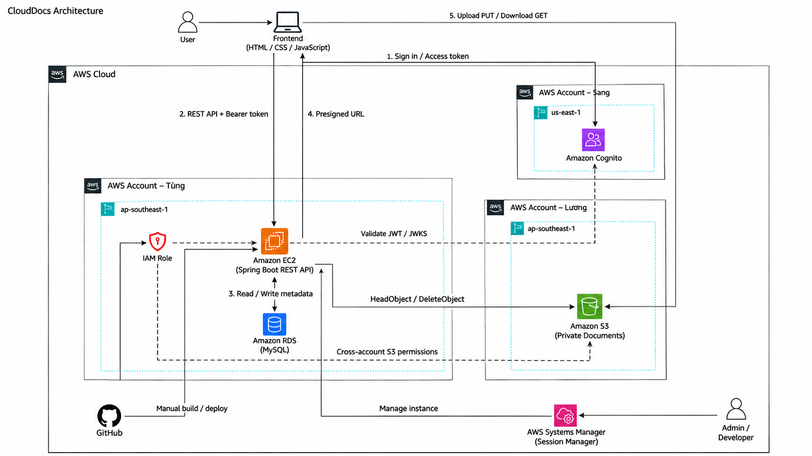

Tại phần này, em trình bày đề xuất **CloudDocs — Hệ thống quản lý tài liệu doanh nghiệp trên nền tảng đám mây AWS**. 

# CloudDocs — Quản lý tài liệu doanh nghiệp trên AWS
## Giải pháp kết hợp Spring Boot, MySQL, S3 và Cognito

### 1. Tóm tắt điều hành

CloudDocs tập trung tài liệu và quy trình xử lý công việc vào một ứng dụng web. ADMIN quản trị tài khoản, tài liệu và thông báo; USER quản lý tài liệu thuộc sở hữu hoặc được chia sẻ. Backend Java 21/Spring Boot 3.5.6 xử lý REST API và phân quyền; frontend HTML/CSS/JavaScript cung cấp giao diện; MySQL lưu metadata, quan hệ chia sẻ, quota và nhật ký nghiệp vụ. Tệp được lưu trên S3 private, xác thực qua Cognito User Pool.

Kiến trúc triển khai mục tiêu sử dụng EC2 chạy ứng dụng và Nginx, RDS MySQL cho cơ sở dữ liệu, IAM Role cho quyền S3. Ứng dụng sử dụng S3 để lưu tài liệu, Cognito để xác thực và MySQL để quản lý dữ liệu nghiệp vụ.

### 2. Tuyên bố vấn đề

*Vấn đề hiện tại*

Tài liệu phân tán trên máy cá nhân hoặc kênh chat khiến khó tra cứu, quản lý quyền và xác định ai đã thay đổi dữ liệu. Việc xóa nhầm, chia sẻ quá rộng, thiếu kiểm soát dung lượng và thiếu liên kết giữa công việc với báo cáo làm giảm khả năng theo dõi.

*Giải pháp*

CloudDocs tổ chức tài liệu theo metadata và phòng ban, hỗ trợ tìm kiếm/lọc, xem trước, tải xuống, chia sẻ theo quyền, yêu thích và thùng rác. Backend kiểm tra quyền trước khi cấp URL có thời hạn; tệp truyền trực tiếp giữa trình duyệt và S3. MySQL lưu thông tin nghiệp vụ và audit. Luồng giao việc–nộp báo cáo–duyệt/yêu cầu sửa là phần mở rộng hiện có đầu tháng 11.

*Lợi ích và hoàn vốn đầu tư (ROI)*

- Giảm thao tác tìm kiếm và chia sẻ thủ công; có thể đo bằng thời gian thực hiện cùng một kịch bản trước/sau.
- Tách tệp khỏi metadata giúp quản lý dữ liệu rõ hơn và hạn chế backend phải trung chuyển nội dung tệp.
- Thùng rác và audit hỗ trợ xử lý nhầm lẫn; quota giới hạn cấp phát theo tài khoản.
- Chưa có dữ liệu vận hành để tính ROI tài chính hoặc tỷ lệ tiết kiệm. Chi phí được lập theo giả định, đối chiếu Billing khi triển khai.

### 3. Kiến trúc giải pháp

*Dịch vụ AWS sử dụng / dự kiến vận hành*

| Nhóm | Thành phần | Vai trò và trạng thái |
| --- | --- | --- |
| Compute | Amazon EC2, Nginx | Môi trường máy chủ ứng dụng; đã kết nối được EC2 |
| Database | Amazon RDS for MySQL | Metadata, users, quyền và audit; đã kết nối được RDS MySQL |
| Storage | Amazon S3 | Bucket private, signed PUT/GET, xác nhận object; đã tích hợp trong mã |
| Identity | Amazon Cognito User Pool | Đăng nhập PKCE, phát hành access token; đã tích hợp trong mã |
| Security/network | IAM Role, VPC, Security Group | Quyền tài nguyên và giới hạn kết nối; cấu hình theo môi trường |
| Operations | CloudWatch, Budgets | Giám sát tài nguyên, thu thập log và theo dõi ngân sách |

*Thiết kế thành phần*

- **Frontend:** giao diện tĩnh; Cognito public app client không chứa client secret. Đổi callback, logout và API_BASE theo môi trường.
- **Backend:** xác thực JWT, đọc role/status từ MySQL, kiểm tra owner_id và quyền tài liệu, quản lý trạng thái upload và quota.
- **RDS/MySQL:** lưu users, documents, permissions, favorites, notifications, audit và work_tasks theo schema phiên bản hiện tại.
- **S3:** object key UUID; tên gốc lưu trong metadata. Luồng metadata → signed PUT → PUT S3 → upload-complete/HEAD; signed GET cấp sau kiểm tra quyền.
- **Cognito:** liên kết issuer/sub, không dùng email để xác định tài khoản; hệ thống phân biệt vai trò ADMIN/USER với quyền tài liệu OWNER/VIEW/DOWNLOAD/EDIT.
- **Luồng local cũ:** endpoint local file còn giữ để tương thích; giao diện hiện hành dùng S3, không kết luận mọi tệp lịch sử đã được chuyển lên S3.

### 4. Triển khai kỹ thuật

*Các giai đoạn triển khai*

1. Khảo sát nghiệp vụ, tìm hiểu AWS và thiết kế ma trận quyền.
2. Xây dựng ERD, backend/frontend và API metadata; quản lý mã nguồn Git.
3. Tích hợp S3 private, CORS, presigned URL, chia sẻ và audit; chuẩn bị test case.
4. Chuẩn bị EC2/RDS, IAM Role, cấu hình Nginx và biến môi trường.
5. Ghép Cognito và kiểm thử tích hợp theo tiến độ thực tế; hoàn thiện quota, thùng rác và luồng công việc ở giai đoạn tiếp theo.

*Yêu cầu kỹ thuật*

- Java 21, Maven, MySQL 8 và Node.js dùng phục vụ frontend/kiểm thử; frontend không phải React và không có bước npm build.
- Schema gốc hợp lệ và migration còn thiếu. Dự án dùng ddl-auto=validate, không tự tạo database từ đầu.
- AWS account, S3 bucket, Cognito pool/client/domain; RDS endpoint; EC2 và IAM Role nếu triển khai cloud.
- Không đưa password, access key, token hoặc client secret vào repository. DB triển khai cần TLS; cấu hình local không được sao chép nguyên trạng sang AWS.

### 5. Lộ trình & Mốc triển khai

| Tuần | Thời gian | Nội dung | Kết quả đạt được |
| --- | --- | --- | --- |
| 1 | 10/08/2026–14/08/2026 | Tài khoản AWS, Budgets và Support | Đã hiểu các bước làm quen và bảo vệ tài khoản AWS. |
| 2 | 17/08/2026–21/08/2026 | AWS IAM và quản lý quyền truy cập | Đã phân biệt được User, Group, Policy và Role. |
| 3 | 24/08/2026–28/08/2026 | Amazon VPC và các thành phần mạng | Đã nắm được các thành phần cơ bản của VPC. |
| 4 | 31/08/2026–04/09/2026 | Amazon EC2 và máy chủ ảo | Đã hiểu quy trình khởi tạo và kết nối EC2. |
| 5 | 07/09/2026–11/09/2026 | Quản lý EC2, EBS và Snapshot | Đã phân biệt được vòng đời Instance, EBS Volume, Snapshot và AMI. |
| 6 | 14/09/2026–18/09/2026 | Amazon S3 và AWS CLI | Đã nắm mô hình Bucket/Object và vai trò AWS CLI. |
| 7 | 21/09/2026–25/09/2026 | Bảo mật S3, CORS và Presigned URL | Đã giải thích được cách bảo vệ bucket và sử dụng Presigned URL. |
| 8 | 28/09/2026–02/10/2026 | Amazon RDS và cơ sở dữ liệu MySQL | Đã nắm thành phần của RDS MySQL và vai trò từng thông số kết nối. |
| 9 | 05/10/2026–09/10/2026 | Sao lưu và bảo mật Amazon RDS | Đã giải thích được Backup, Snapshot, Restore và mục đích Multi-AZ. |
| 10 | 12/10/2026–16/10/2026 | Amazon Cognito và quản lý người dùng | Đã nắm vai trò User Pool, App Client và cấu hình đăng nhập. |
| 11 | 19/10/2026–23/10/2026 | Luồng xác thực Cognito và JWT | Đã giải thích được luồng xác thực Cognito và vai trò các loại token. |
| 12 | 26/10/2026–30/10/2026 | Mối liên hệ giữa các dịch vụ AWS | Đã mô tả được kiến trúc ứng dụng sử dụng các dịch vụ AWS đã học. |

### 6. Ước tính ngân sách

*Giả định demo:* một EC2, một RDS MySQL Single-AZ, 5 GB tệp S3, 20 GB EBS, khoảng 10 người dùng, chạy hạ tầng 160 giờ/tháng để học tập. Đây là giả định lập dự toán, không phải số đo hay báo giá AWS.

| Hạng mục | Cách tính cần nhập vào AWS Pricing Calculator |
| --- | --- |
| EC2 compute | Giá instance/giờ × 160 giờ; so sánh 730 giờ nếu chạy liên tục |
| EBS | 20 GB × giá GB-tháng, kể cả lúc EC2 dừng |
| RDS compute | Giá DB instance/giờ × số giờ chạy thực tế |
| RDS storage/backup | Dung lượng cấp phát × giá GB-tháng, cộng backup/snapshot tính phí |
| S3 | 5 GB-tháng + PUT/GET/HEAD + truyền dữ liệu theo thực tế |
| Public IPv4 và mạng | Số IP × giờ tính phí; thêm NAT Gateway hoặc endpoint nếu có |
| Cognito | MAU và tính năng/tier theo tài khoản |
| CloudWatch/Budgets | Lượng log, retention, metric/alarm và tính năng ngân sách đã chọn |
| Tên miền/HTTPS | Chỉ cộng dịch vụ được chọn; không tự ghi Route 53/ALB là đã dùng |
| Tổng | Tổng các dòng theo Region, cấu hình và giá tại ngày lập dự toán |

Ngân sách được tính theo Region, cấu hình tài nguyên, thời gian sử dụng và đơn giá tại thời điểm triển khai. Công cụ lập dự toán là [AWS Pricing Calculator](https://calculator.aws/); số liệu vận hành được theo dõi qua AWS Billing. Các khoản lưu trữ, snapshot và địa chỉ IP được tính riêng theo cấu hình thực tế.

### 7. Đánh giá rủi ro

*Ma trận rủi ro*

| Rủi ro | Ảnh hưởng | Khả năng định tính |
| --- | --- | --- |
| Sai IAM, CORS hoặc Region làm lỗi S3 | Cao | Trung bình |
| RDS không kết nối / sai schema | Cao | Trung bình |
| Sai callback, issuer hoặc app client | Cao | Trung bình |
| Không nhất quán metadata/object sau lỗi upload | Cao | Trung bình |
| URL đã cấp còn hiệu lực khi thu hồi quyền | Trung bình | Là đặc tính thiết kế hiện tại |
| Chạy migration lặp hoặc nhầm database | Cao | Trung bình |
| Chi phí tài nguyên tồn dư | Trung bình | Trung bình |

*Chiến lược giảm thiểu*

Giữ bucket private, dùng IAM Role giới hạn prefix, kiểm tra quyền ở backend và đặt URL thời hạn ngắn. Sao lưu DB, preflight migration, đối soát HEAD object và kiểm thử tài khoản khác nhau. Cấu hình SG theo nguồn được phép, TLS khi kết nối RDS, quản lý secrets ngoài mã nguồn. Ghi nhận chi phí và dọn tài nguyên demo khi kết thúc.

*Kế hoạch dự phòng*

Giữ bản build trước, bản sao DB và cấu hình môi trường có kiểm soát. Nếu EC2 chưa sẵn sàng, trình diễn ứng dụng local kết nối dịch vụ được phép và ghi đúng môi trường demo. Không khôi phục DB tùy tiện lên dữ liệu đang sử dụng; thử phục hồi trên bản sao trước.

### 8. Kết quả kỳ vọng

*Cải tiến kỹ thuật*

- Trình diễn được đăng nhập, upload, preview/download, chia sẻ/thu hồi và audit với hai vai trò.
- Đối chiếu được quota, thùng rác, khôi phục và xóa vĩnh viễn với metadata/S3.
- Trình diễn công việc, nộp báo cáo, chờ duyệt, yêu cầu sửa và nộp muộn ở phiên bản mở rộng.
- Có tài liệu triển khai, cấu hình môi trường và kịch bản kiểm thử theo đúng mã nguồn.

*Giá trị dài hạn*

Rèn kỹ năng backend, xác thực, phân quyền, dữ liệu quan hệ, lưu trữ đối tượng và tự tìm hiểu kiến trúc ứng dụng. Hướng mở rộng gồm tự động hóa triển khai, tăng khả năng phục hồi, quét tệp, theo dõi phiên bản báo cáo và giám sát; chỉ đưa vào kết quả đã làm khi có triển khai thực tế.

## Tài liệu tham khảo

- [First Cloud AI Journey](https://cloudjourney.awsfcaj.com/)
- [AWS Documentation](https://docs.aws.amazon.com/)
- Đề cương thực tập chuyên ngành và tài liệu kỹ thuật CloudDocs.
