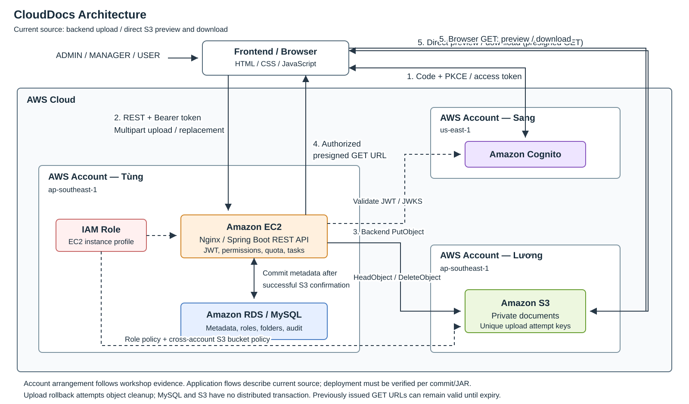

## Introduction

CloudDocs is an enterprise document management system that has been developed and integrated with AWS services. The project uses Amazon EC2 for the application environment, Amazon RDS MySQL for business data, Amazon S3 for private document storage and Amazon Cognito for user authentication.

This workshop presents the architecture, configuration steps and practical results of the system. Screenshots in the following sections illustrate AWS settings and functions exercised in CloudDocs.

## Workshop objectives

- Understand the roles and relationships of EC2, RDS MySQL, S3, Cognito and IAM in the system.
- Understand environment configuration, service connections and application deployment.
- Explain sign-in, upload, preview, download and document authorization flows.
- Compare practical results using AWS configuration, application screens and activity logs.

## Architecture overview

The HTML, CSS and JavaScript frontend communicates with the Spring Boot backend through REST APIs. The backend connects to RDS MySQL for metadata and business data, verifies identities issued by Cognito and receives multipart requests to upload files to S3. For preview/download, it issues presigned GET URLs for direct browser access to S3. An IAM role and bucket policy authorize cross-account S3 access as shown in the diagram.

## Main processing flows

1. The user signs in through Cognito using Authorization Code + PKCE; the frontend receives an access token.
2. The frontend sends REST API requests with a Bearer token; the backend validates the JWT and checks the account and role in MySQL.
3. The frontend sends `POST /api/documents/upload` as multipart with `file`, `metadata`, `requestId` and optional `folderId`. The backend checks the quota and folder scope before completing the transaction.
4. The backend stores the file in S3, checks it with HeadObject and commits metadata only after success. Retrying the same account-scoped `requestId` returns the saved document if compatible; on failure, data is rolled back and cleanup of the upload attempt's object is attempted.
5. For preview or download, the backend checks current permissions and issues a time-limited presigned GET URL.
6. Sharing, trash, restore, task assignment and report review are handled by the backend; business records and activity logs are stored in MySQL.

## Completed functionality

The system includes sign-in and sign-out, document management, upload, preview, download, search, permission-based sharing, favorites, trash and restore. User management, storage statistics, activity logs, notifications and the task assignment – report submission – approval workflow have also been added to the application.

The current source also contains the following functions; existing practice screenshots do not illustrate every new function:

| Group | Functions in the current source |
| --- | --- |
| Department authorization | ADMIN/MANAGER/USER; MANAGER previews documents owned by accounts in the same department and assigns work to USER accounts in that department |
| Folders | Create subfolders, rename and move one/multiple files; moving preserves S3 keys, shares and favorites |
| Sharing and content | Sent shares supports changing/revoking permissions; content replacement preserves document IDs and existing relationships |
| Profiles and administration | Manage departments, assign staff, update profiles and avatars |
| Interface | Pagination of 20 items on main lists, search/filter/sort and browser history navigation |

Pagination currently operates on data already loaded in the browser rather than database queries. Backend upload avoids completing metadata before a file is stored, but requires appropriate multipart limits in Nginx and the backend. Failed object cleanup requires log reconciliation because S3 and MySQL have no distributed transaction.

Practical illustrations of these functions appear in [4.8. Business and integration testing](../4.8-Smoke-Test/). The configuration sections below combine procedural guidance with screenshots from the practice environment so that readers can compare each architecture component.
