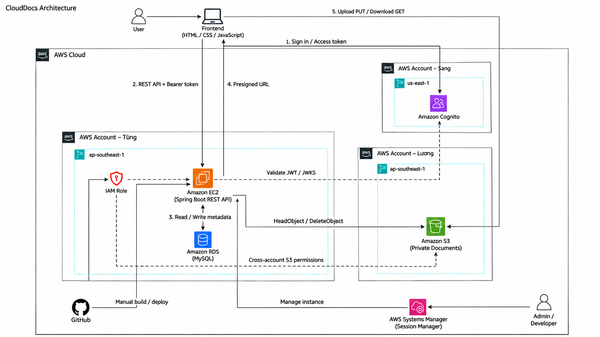

# CloudDocs deployment overview on AWS

## Introduction

CloudDocs is an enterprise document management system that has been developed and integrated with AWS services. The project uses Amazon EC2 for the application environment, Amazon RDS MySQL for business data, Amazon S3 for private document storage and Amazon Cognito for user authentication.

This workshop presents the architecture, configuration steps and practical results of the system. Screenshots in the following sections illustrate AWS settings and functions exercised in CloudDocs.

## Workshop objectives

- Understand the roles and relationships of EC2, RDS MySQL, S3, Cognito and IAM in the system.
- Understand environment configuration, service connections and application deployment.
- Explain sign-in, upload, preview, download and document authorization flows.
- Compare practical results using AWS configuration, application screens and activity logs.

## Architecture overview

The HTML, CSS and JavaScript frontend communicates with the Spring Boot backend through REST APIs. The backend connects to RDS MySQL for metadata and business data, verifies identities issued by Cognito and creates presigned URLs for direct browser-to-S3 file transfers. An IAM role and bucket policy authorize cross-account S3 access as shown in the diagram.

## Main processing flows

1. The user signs in through Cognito using Authorization Code + PKCE; the frontend receives an access token.
2. The frontend sends REST API requests with a Bearer token; the backend validates the JWT and checks the account and role in MySQL.
3. For upload, the backend creates metadata, checks the quota and issues a presigned PUT URL; the browser sends the file directly to S3.
4. The frontend confirms completion; the backend checks the object with HeadObject and updates the document size.
5. For preview or download, the backend checks current permissions and issues a time-limited presigned GET URL.
6. Sharing, trash, restore, task assignment and report review are handled by the backend; business records and activity logs are stored in MySQL.

## Completed functionality

The system includes sign-in and sign-out, document management, upload, preview, download, search, permission-based sharing, favorites, trash and restore. User management, storage statistics, activity logs, notifications and the task assignment – report submission – approval workflow have also been added to the application.

Practical illustrations of these functions appear in [4.8. Business and integration testing](../4.8-Smoke-Test/). The configuration sections below combine procedural guidance with screenshots from the practice environment so that readers can compare each architecture component.
