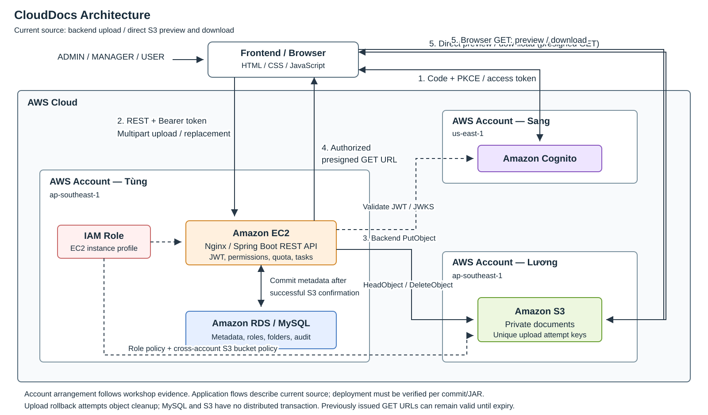

## Giới thiệu

CloudDocs là hệ thống quản lý tài liệu doanh nghiệp đã được xây dựng và tích hợp với các dịch vụ AWS. Dự án sử dụng Amazon EC2 cho môi trường ứng dụng, Amazon RDS MySQL để quản lý dữ liệu nghiệp vụ, Amazon S3 để lưu trữ tài liệu riêng tư và Amazon Cognito để xác thực người dùng.

Workshop trình bày kiến trúc, các bước cấu hình và kết quả thực hành của hệ thống. Những ảnh tại các mục tiếp theo minh họa cấu hình AWS và các chức năng đã thực hiện trên CloudDocs.

## Mục tiêu workshop

- Hiểu vai trò và mối liên hệ giữa EC2, RDS MySQL, S3, Cognito và IAM trong hệ thống.
- Nắm được quy trình cấu hình môi trường, kết nối các dịch vụ và triển khai ứng dụng.
- Giải thích được luồng đăng nhập, tải lên, xem trước, tải xuống và phân quyền tài liệu.
- Đối chiếu kết quả thực hành qua cấu hình AWS, giao diện ứng dụng và nhật ký hoạt động.

## Kiến trúc tổng quan

Frontend sử dụng HTML, CSS và JavaScript, giao tiếp với backend Spring Boot qua REST API. Backend kết nối RDS MySQL để đọc/ghi metadata và dữ liệu nghiệp vụ, kiểm tra danh tính từ Cognito và nhận multipart để tải tệp lên S3. Khi xem trước/tải xuống, backend cấp presigned GET để trình duyệt đọc trực tiếp từ S3. IAM Role cùng bucket policy cấp quyền truy cập S3 giữa các tài khoản theo sơ đồ.

## Luồng xử lý chính

1. Người dùng đăng nhập qua Cognito bằng Authorization Code + PKCE; frontend nhận access token.
2. Frontend gửi yêu cầu REST API kèm Bearer token; backend xác thực JWT và kiểm tra tài khoản, vai trò trong MySQL.
3. Frontend gửi `POST /api/documents/upload` dạng multipart gồm `file`, `metadata`, `requestId` và `folderId` tùy chọn. Backend kiểm tra hạn mức và phạm vi thư mục trước khi hoàn tất giao dịch.
4. Backend lưu tệp lên S3, kiểm tra object bằng HeadObject và chỉ commit metadata sau khi thành công. Thử lại cùng `requestId` theo tài khoản trả về tài liệu đã lưu nếu phù hợp; khi lỗi, rollback dữ liệu và thử dọn object của lần tải.
5. Khi xem trước hoặc tải xuống, backend kiểm tra quyền hiện tại rồi cấp presigned URL GET có thời hạn.
6. Các thao tác chia sẻ, thùng rác, khôi phục, giao việc và duyệt báo cáo được xử lý tại backend; dữ liệu nghiệp vụ và nhật ký được lưu trong MySQL.

## Chức năng đã hoàn thành

Hệ thống đã có đăng nhập và đăng xuất, quản lý tài liệu, tải lên, xem trước, tải xuống, tìm kiếm, chia sẻ theo quyền, yêu thích, thùng rác và khôi phục. Các chức năng quản lý người dùng, thống kê dung lượng, nhật ký hoạt động, thông báo và giao việc – nộp báo cáo – duyệt báo cáo đã được bổ sung vào ứng dụng.

Đối chiếu mã nguồn hiện tại còn ghi nhận các chức năng sau; ảnh thực hành hiện có chưa minh họa đầy đủ từng chức năng mới:

| Nhóm | Chức năng trong mã nguồn hiện tại |
| --- | --- |
| Phân quyền phòng ban | ADMIN/MANAGER/USER; MANAGER xem tài liệu của chủ sở hữu cùng phòng ban và giao việc cho USER cùng phòng |
| Thư mục | Tạo thư mục con, đổi tên, chuyển một/nhiều tệp; di chuyển giữ S3 key, quyền chia sẻ và yêu thích |
| Chia sẻ và nội dung | Trang Đã chia sẻ cho phép đổi/thu hồi quyền; ghi đè nội dung giữ ID tài liệu và các quan hệ hiện có |
| Hồ sơ và quản trị | Quản lý phòng ban, gán nhân viên, cập nhật hồ sơ và avatar |
| Giao diện | Phân trang 20 mục trên các danh sách chính, tìm kiếm/lọc/sắp xếp và điều hướng bằng lịch sử trình duyệt |

Phân trang hiện thực hiện trên dữ liệu đã tải về trình duyệt, chưa phải phân trang truy vấn database. Upload qua backend giúp tránh hoàn tất metadata khi tệp chưa được lưu; đổi lại cần cấu hình giới hạn multipart tại Nginx và backend. Nếu dọn object sau lỗi thất bại, cần đối soát log vì S3 và MySQL không có giao dịch phân tán.

Minh họa thực tế của các nhóm chức năng được trình bày tại [4.8. Kiểm thử nghiệp vụ và tích hợp](../4.8-Smoke-Test/). Các mục cấu hình bên dưới kết hợp hướng dẫn thao tác với ảnh môi trường thực hành để người đọc đối chiếu từng thành phần trong kiến trúc.
