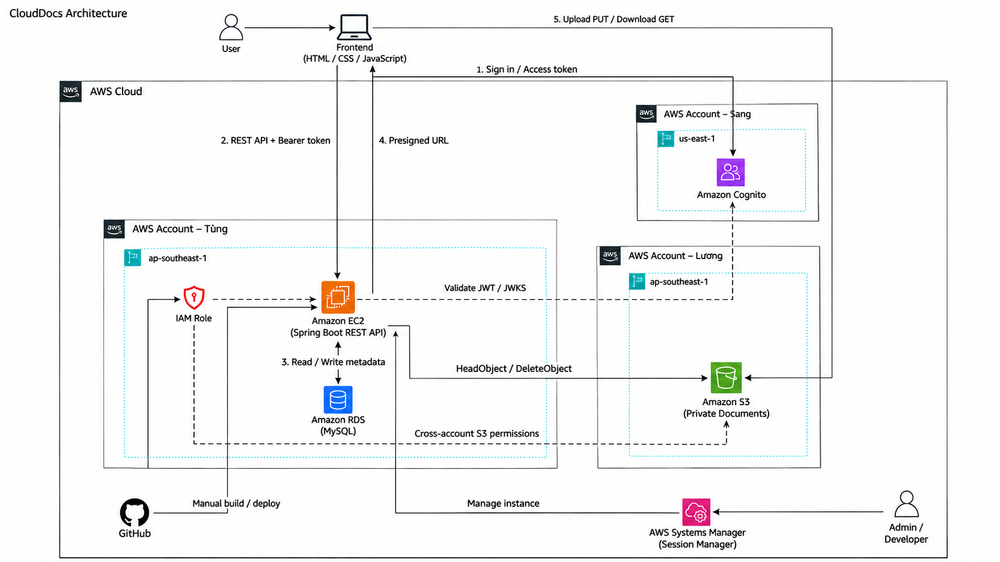

# Tổng quan triển khai CloudDocs trên AWS

## Giới thiệu

CloudDocs là hệ thống quản lý tài liệu doanh nghiệp đã được xây dựng và tích hợp với các dịch vụ AWS. Dự án sử dụng Amazon EC2 cho môi trường ứng dụng, Amazon RDS MySQL để quản lý dữ liệu nghiệp vụ, Amazon S3 để lưu trữ tài liệu riêng tư và Amazon Cognito để xác thực người dùng.

Workshop trình bày kiến trúc, các bước cấu hình và kết quả thực hành của hệ thống. Những ảnh tại các mục tiếp theo minh họa cấu hình AWS và các chức năng đã thực hiện trên CloudDocs.

## Mục tiêu workshop

- Hiểu vai trò và mối liên hệ giữa EC2, RDS MySQL, S3, Cognito và IAM trong hệ thống.
- Nắm được quy trình cấu hình môi trường, kết nối các dịch vụ và triển khai ứng dụng.
- Giải thích được luồng đăng nhập, tải lên, xem trước, tải xuống và phân quyền tài liệu.
- Đối chiếu kết quả thực hành qua cấu hình AWS, giao diện ứng dụng và nhật ký hoạt động.

## Kiến trúc tổng quan

Frontend sử dụng HTML, CSS và JavaScript, giao tiếp với backend Spring Boot qua REST API. Backend kết nối RDS MySQL để đọc/ghi metadata và dữ liệu nghiệp vụ, kiểm tra danh tính từ Cognito và cấp presigned URL để trình duyệt truyền tệp trực tiếp với S3. IAM Role cùng bucket policy cấp quyền truy cập S3 giữa các tài khoản theo sơ đồ.

## Luồng xử lý chính

1. Người dùng đăng nhập qua Cognito bằng Authorization Code + PKCE; frontend nhận access token.
2. Frontend gửi yêu cầu REST API kèm Bearer token; backend xác thực JWT và kiểm tra tài khoản, vai trò trong MySQL.
3. Khi tải lên, backend tạo metadata, kiểm tra hạn mức và cấp presigned URL PUT; trình duyệt gửi tệp trực tiếp lên S3.
4. Frontend xác nhận hoàn tất; backend kiểm tra object bằng HeadObject và cập nhật kích thước tài liệu.
5. Khi xem trước hoặc tải xuống, backend kiểm tra quyền hiện tại rồi cấp presigned URL GET có thời hạn.
6. Các thao tác chia sẻ, thùng rác, khôi phục, giao việc và duyệt báo cáo được xử lý tại backend; dữ liệu nghiệp vụ và nhật ký được lưu trong MySQL.

## Chức năng đã hoàn thành

Hệ thống đã có đăng nhập và đăng xuất, quản lý tài liệu, tải lên, xem trước, tải xuống, tìm kiếm, chia sẻ theo quyền, yêu thích, thùng rác và khôi phục. Các chức năng quản lý người dùng, thống kê dung lượng, nhật ký hoạt động, thông báo và giao việc – nộp báo cáo – duyệt báo cáo đã được bổ sung vào ứng dụng.

Minh họa thực tế của các nhóm chức năng được trình bày tại [4.8. Kiểm thử nghiệp vụ và tích hợp](../4.8-Smoke-Test/). Các mục cấu hình bên dưới kết hợp hướng dẫn thao tác với ảnh môi trường thực hành để người đọc đối chiếu từng thành phần trong kiến trúc.
