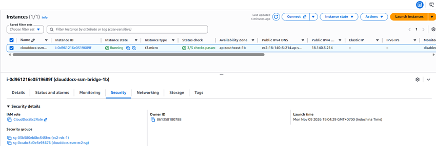
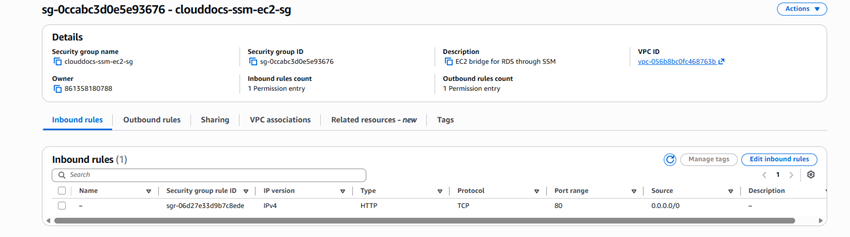
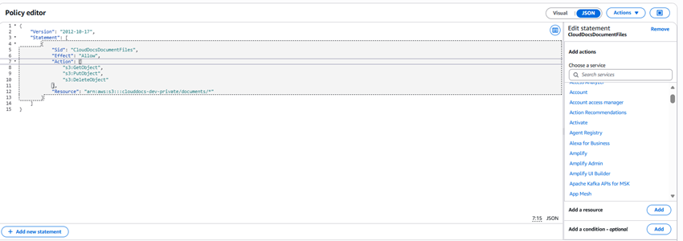
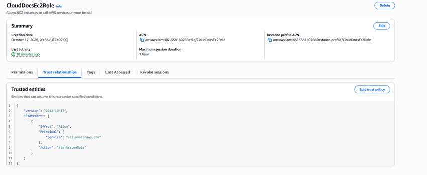

## 1. Select the account and network

Identify the account/Region and add Project=CloudDocs and Environment=demo tags to supported resources. Use an appropriate existing VPC or create a lab VPC: EC2 needs a subnet with suitable outbound connectivity; RDS needs a DB subnet group covering subnets in at least two Availability Zones. A Single-AZ RDS instance still requires a valid subnet group.

## 2. Security groups

| Group | Intended inbound access | Notes |
| --- | --- | --- |
| clouddocs-web-sg | Port 443 from users; port 80 for redirects/certificate issuance if needed | Nginx terminates TLS; do not expose port 8080 |
| clouddocs-db-sg | Port 3306 from clouddocs-web-sg | Do not expose MySQL to the entire Internet |
| Administration | Session Manager with the required permissions/connectivity; IP-restricted SSH if needed | Session Manager does not work without its prerequisites |

A private RDS instance cannot be reached directly from a laptop over the Internet. Use an authorized administrative path such as a tunnel, SSM, VPN or operations from EC2; do not make it public simply to bypass a network error.

## 3. EC2 IAM role

Create a role trusted by EC2 and attach a policy scoped to the project's bucket/prefix. Replace ACCOUNT/BUCKET for the deployment environment before applying the example:

~~~json
{
  "Version": "2012-10-17",
  "Statement": [
    {"Effect":"Allow","Action":"s3:ListBucket","Resource":"arn:aws:s3:::YOUR_BUCKET","Condition":{"StringLike":{"s3:prefix":["documents","documents/*"]}}},
    {"Effect":"Allow","Action":["s3:GetObject","s3:PutObject","s3:DeleteObject"],"Resource":"arn:aws:s3:::YOUR_BUCKET/documents/*"}
  ]
}
~~~

Attach the role using an instance profile; the backend uses the default credential provider chain. HeadObject requires GetObject permission. SSE-KMS requires appropriate KMS permissions and key policy. Do not send AWS access keys to the frontend.

## 4. Cross-account access, if applicable

Configure this only for the actual deployment accounts. AssumeRole requires the trust policy, sts:AssumeRole permission and matching credential flow; a policy on only one side is insufficient. Direct resource-policy access requires checking both the role and bucket policies. This is an environment-dependent deployment option, not an assumed existing configuration.

**Verification:** EC2 reaches RDS through the correct security groups; the backend has Get/Put/Delete access to the project prefix; public origins cannot access database/backend ports.

<!-- workshop-evidence -->

## Practice and illustrated results

### T02. EC2 IAM role

Open EC2 → Instances → select the instance → Security to inspect the IAM role and security groups. The screenshot records CloudDocsEc2Role attached to the administration bridge instance.

### T03. EC2 security group inbound rules

Open the security group → Inbound rules. The pictured clouddocs-ssm-ec2-sg allows HTTP on port 80 from 0.0.0.0/0. This records a demo configuration; it does not demonstrate HTTPS or a review of every group attached to the instance.

### T04. S3 access policy contents

In IAM, inspect the policy allowing GetObject, PutObject and DeleteObject on clouddocs-dev-private/documents/*. The screenshot shows the policy editor and documents the intended permissions; verify that the saved policy is attached to the role when validating access.

### T05. Role trust relationship

Open IAM → Roles → CloudDocsEc2Role → Trust relationships. The ec2.amazonaws.com principal and sts:AssumeRole allow EC2 to assume the role; S3 operations are separately governed by permission and bucket policies.

