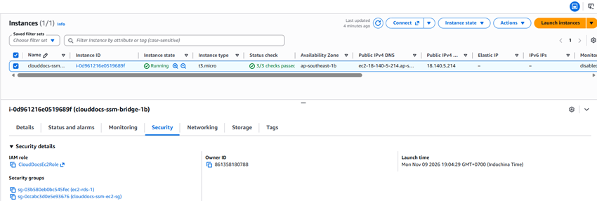
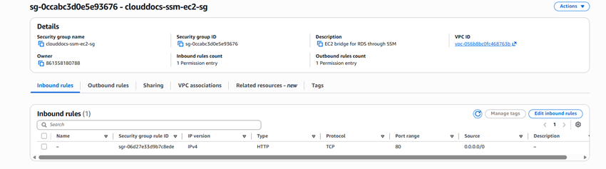
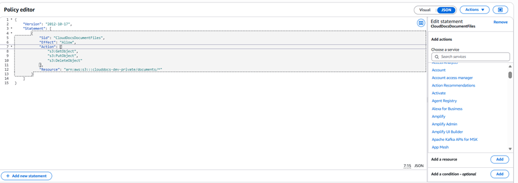
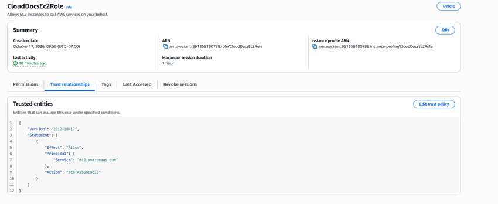

## 1. Chọn tài khoản và mạng

Xác định account/Region, gắn tag Project=CloudDocs và Environment=demo cho tài nguyên hỗ trợ. Dùng VPC hiện có hợp lệ hoặc tạo VPC lab: EC2 ở subnet có đường ra phù hợp, RDS ở DB subnet group gồm subnet thuộc ít nhất hai Availability Zone. RDS Single-AZ vẫn cần subnet group hợp lệ.

## 2. Security Group

| Nhóm | Inbound dự kiến | Ghi chú |
| --- | --- | --- |
| clouddocs-web-sg | 443 từ người dùng; 80 nếu chuyển hướng/cấp chứng chỉ | Nginx kết thúc TLS; không công khai 8080 |
| clouddocs-db-sg | 3306 từ clouddocs-web-sg | Không mở MySQL ra toàn Internet |
| Quản trị | Session Manager nếu cấu hình đủ quyền/kết nối; SSH giới hạn IP nếu cần | Không giả định Session Manager tự hoạt động |

RDS private không kết nối trực tiếp từ laptop qua Internet. Dùng đường quản trị được cho phép như tunnel/SSM/VPN hoặc thao tác từ EC2; không sửa thành public chỉ để bỏ qua lỗi mạng.

## 3. IAM Role cho EC2

Tạo role trust EC2, gắn policy chỉ cho bucket/prefix của dự án. Đây là mẫu; thay ACCOUNT/BUCKET theo môi trường trước khi áp dụng:

~~~json
{
  "Version": "2012-10-17",
  "Statement": [
    {"Effect":"Allow","Action":"s3:ListBucket","Resource":"arn:aws:s3:::YOUR_BUCKET","Condition":{"StringLike":{"s3:prefix":["documents","documents/*"]}}},
    {"Effect":"Allow","Action":["s3:GetObject","s3:PutObject","s3:DeleteObject"],"Resource":"arn:aws:s3:::YOUR_BUCKET/documents/*"}
  ]
}
~~~

Gắn role qua instance profile, backend dùng default credential provider chain. HeadObject sử dụng quyền GetObject; nếu chọn SSE-KMS cần bổ sung quyền KMS và key policy phù hợp. Không đưa khóa AWS xuống frontend.

## 4. Chéo tài khoản nếu có

Chỉ cấu hình theo tài khoản triển khai thật. Nếu ứng dụng dùng AssumeRole cần trust policy, quyền sts:AssumeRole và credential flow tương ứng; không chỉ thêm policy một phía. Với resource policy trực tiếp cần kiểm tra cả policy của role và bucket. Nội dung này là nhánh triển khai tùy môi trường, không mặc định đã được dùng.

**Kiểm tra:** EC2 kết nối RDS qua SG đúng; backend có Get/Put/Delete trên prefix dự án; origin công khai không truy cập cổng DB/backend.

<!-- workshop-evidence -->

## Thực hành và kết quả minh họa

### T02. IAM Role gắn với EC2

Mở EC2 → Instances → chọn máy → Security để đối chiếu IAM Role và các Security Group. Ảnh ghi nhận CloudDocsEc2Role được gắn với máy cầu nối quản trị.

### T03. Inbound của Security Group EC2

Mở Security Group → Inbound rules. Nhóm clouddocs-ssm-ec2-sg trong ảnh cho phép HTTP cổng 80 từ 0.0.0.0/0. Đây là cấu hình demo được ghi nhận; ảnh không chứng minh HTTPS hay toàn bộ các nhóm gắn với EC2 đã được kiểm tra.

### T04. Nội dung policy truy cập S3

Trong IAM, đối chiếu policy cho phép GetObject, PutObject và DeleteObject tại clouddocs-dev-private/documents/*. Ảnh đang ở trình soạn thảo policy, minh họa nội dung quyền; cần đối chiếu policy đã lưu và gắn với role khi nghiệm thu truy cập.

### T05. Trust relationship của role

Mở IAM → Roles → CloudDocsEc2Role → Trust relationships. Principal ec2.amazonaws.com cùng sts:AssumeRole cho phép dịch vụ EC2 đảm nhận role; quyền thao tác S3 vẫn do permission policy và bucket policy quyết định.

