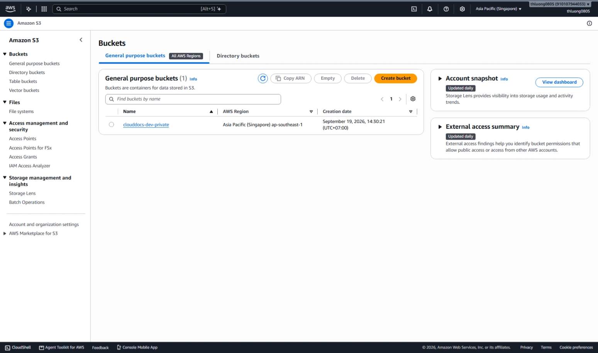
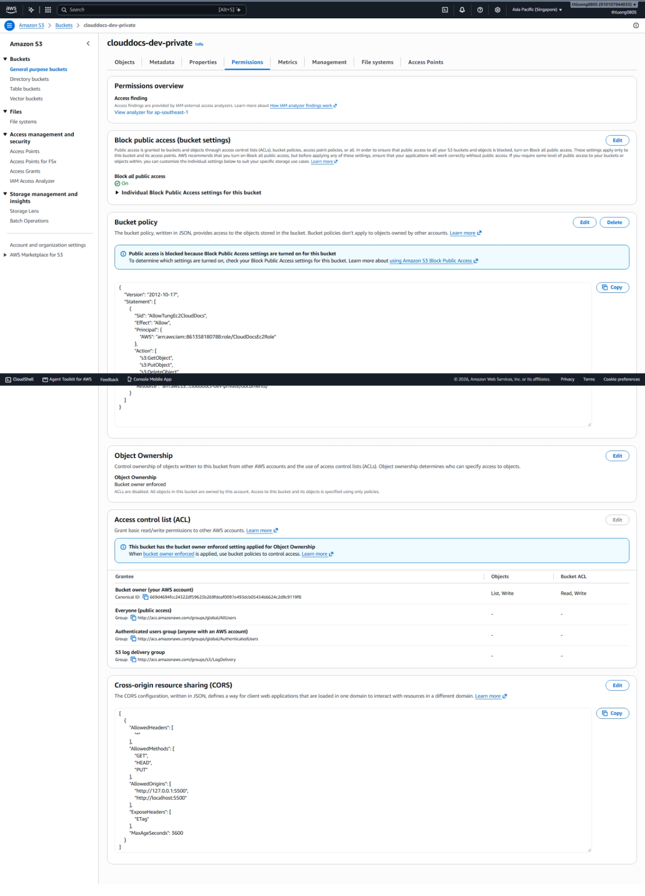
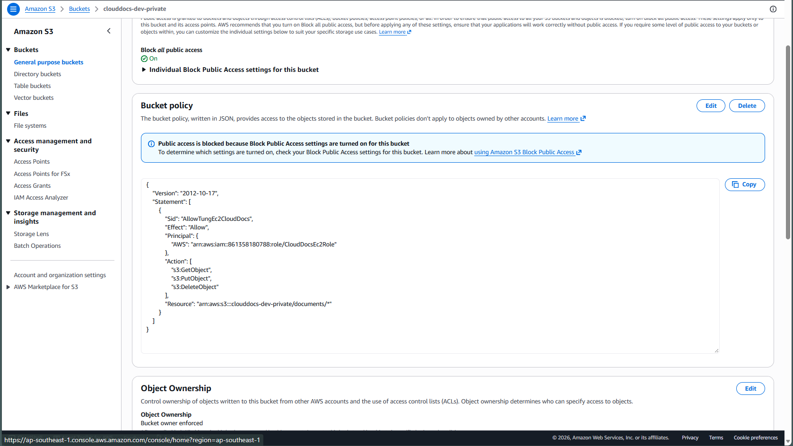
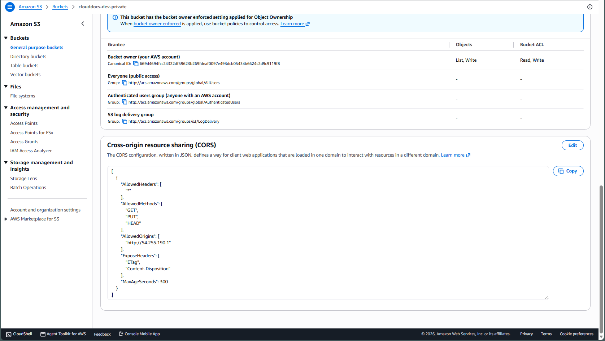
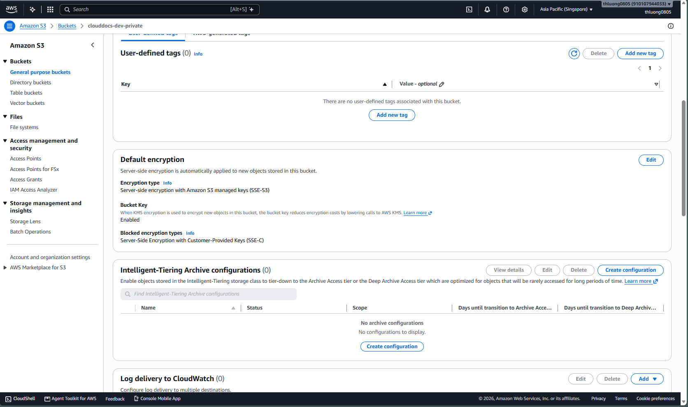
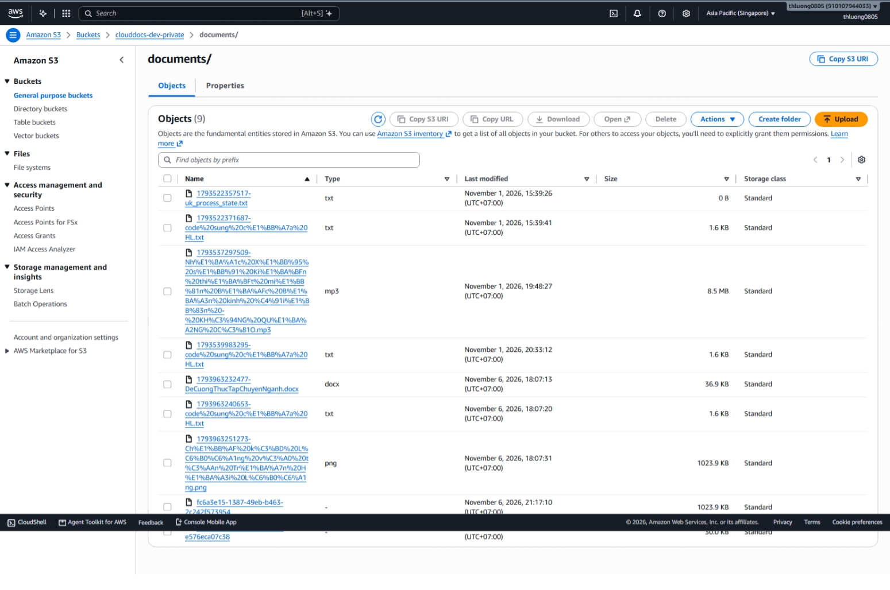
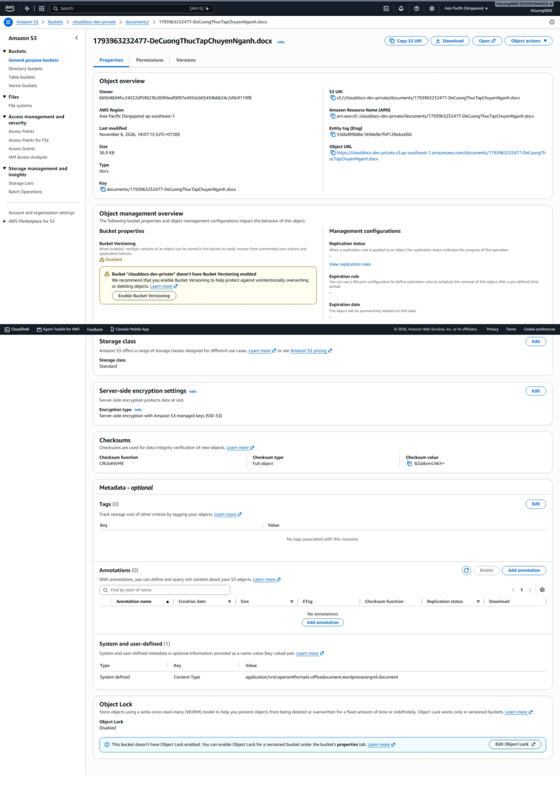

## 1. Create or verify the bucket

In the S3 Console, select the project bucket in the agreed Region. Keep **Block Public Access**, **Bucket owner enforced** Object Ownership and default encryption enabled. Review existing data before changing an active bucket. Do not enable public website hosting for the document bucket.

The backend uses the documents/ prefix and UUID keys. Policy, CORS and script examples are in Back_end/aws/s3. Running these tools changes infrastructure; they are not mandatory application startup steps.

## 2. Configure CORS for the actual origin

Example for S3 Console → Permissions → CORS; replace the origin:

~~~json
[
  {
    "AllowedHeaders": ["*"],
    "AllowedMethods": ["GET", "HEAD", "PUT"],
    "AllowedOrigins": ["https://YOUR_FRONTEND_HOST"],
    "ExposeHeaders": ["ETag"],
    "MaxAgeSeconds": 3600
  }
]
~~~

The Console expects the **array of rules** shown above. AWS CLI JSON wraps rules in a CORSRules object, as in the repository example. For local development, add the exact active origin, such as http://localhost:5500 or http://127.0.0.1:5500. CORS does not replace IAM or make a bucket public.

## 3. Backend configuration

| Variable | Required value |
| --- | --- |
| AWS_REGION | Actual bucket Region |
| S3_BUCKET | The project's bucket name |
| S3_PRESIGN_EXPIRY | Lifetime in seconds; current default is 900 and may be reduced as required |

## 4. Test the normal workflow

1. Sign in and create metadata with POST /api/documents.
2. Call POST /api/documents/{id}/upload-url; use the current UI/DTO rather than guessing JSON fields.
3. The frontend sends the File with PUT to the S3 URL, preserving signed headers.
4. Call POST /api/documents/{id}/upload-complete; the backend verifies the object with HEAD and confirms its size.
5. Request GET preview-url/download-url using an authorized account and open the newly issued URL.

**Expected result:** the private object exists, metadata confirms the upload and unshared accounts are denied access. Previously signed URLs may remain usable until expiration; temporary credential expiration can invalidate them earlier.

## Common errors

For HTTP 403, check the signing principal, policy, prefix, Region, headers and expiration. For CORS, compare the complete scheme/host/port origin and test in a browser. When metadata exists but the file is missing, do not treat the upload as complete; handle the pending allocation through the application workflow.

See [CORS](https://docs.aws.amazon.com/AmazonS3/latest/userguide/cors.html) and [presigned URLs](https://docs.aws.amazon.com/AmazonS3/latest/userguide/using-presigned-url.html).

<!-- workshop-evidence -->

## Practice and illustrated results

### H01. Bucket and Region

Open S3 → Buckets. The clouddocs-dev-private bucket is in Asia Pacific (Singapore), ap-southeast-1; configure the backend S3 client for this Region.

### H02. Block public access

Under Permissions, Block all public access is On and Object Ownership is Bucket owner enforced. Documents use authorized access rather than a public bucket website.

### H03. Cross-account bucket policy

The bucket policy allows CloudDocsEc2Role in account 861358180788 to read, write and delete objects under documents/*. Compare the role ARN with T02/T05 and its permission policy. This is resource-policy access, not evidence that the application assumes a separate S3 role.

### H04. Saved CORS configuration

Under Permissions → CORS, the saved configuration allows GET, PUT and HEAD from http://54.255.190.1; ExposeHeaders contains ETag and Content-Disposition, and MaxAgeSeconds is 300. This is the origin recorded at capture time; synchronize it when the frontend host or port changes.

### H05. Default SSE-S3 encryption

Open Properties → Default encryption. The encryption type is SSE-S3 with Amazon S3 managed keys; this is not an SSE-KMS configuration.

### H06. Stored objects under documents/

Open Objects → documents/ to compare keys, file types, sizes and modification times. The list contains both older and newer test keys; it does not imply that every object was created by the same application version.

### H07. Individual object properties

Select DeCuongThucTapChuyenNganh.docx → Properties. The screenshot records a documents/ key, a 36.9 KB size, Standard storage and SSE-S3; Bucket Versioning is Disabled. These properties complement the H06 object list.

