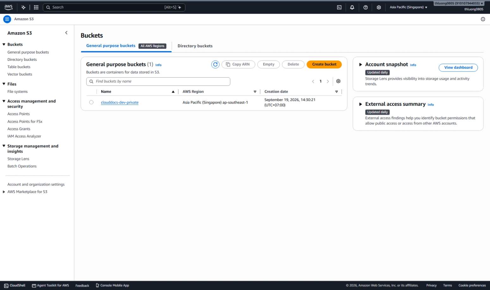
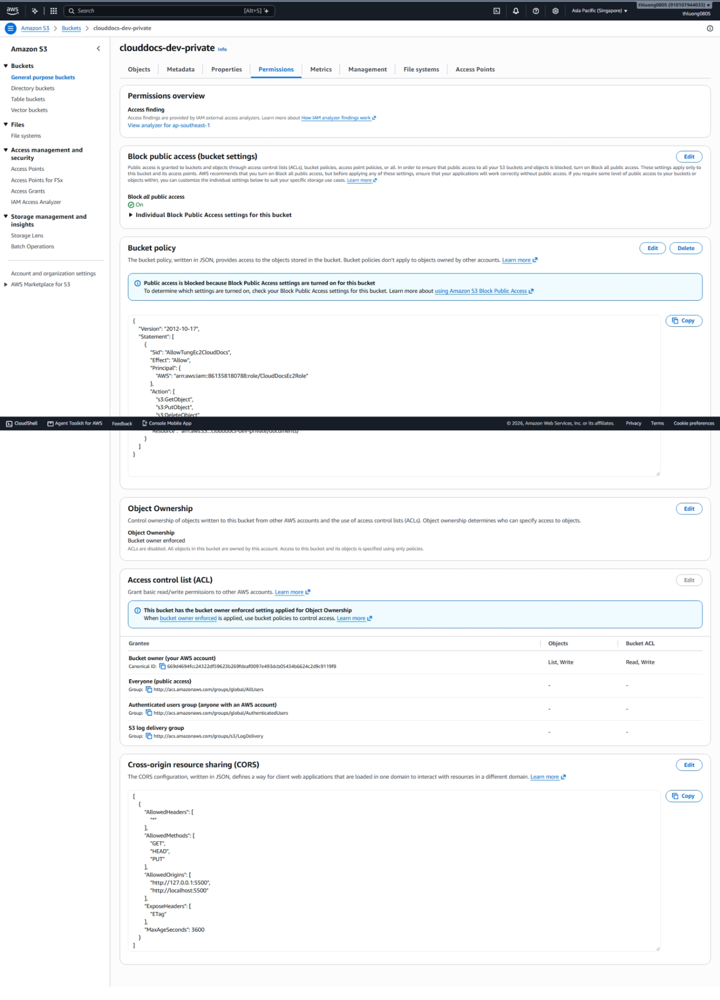
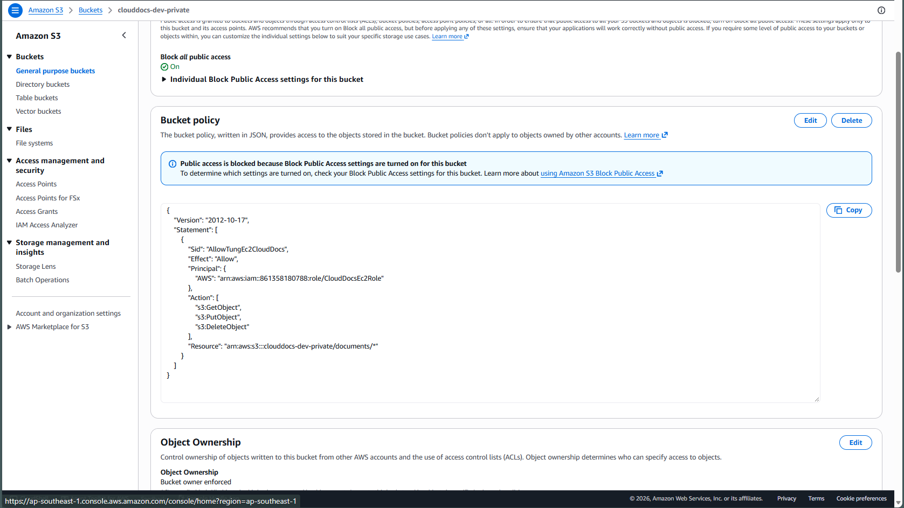
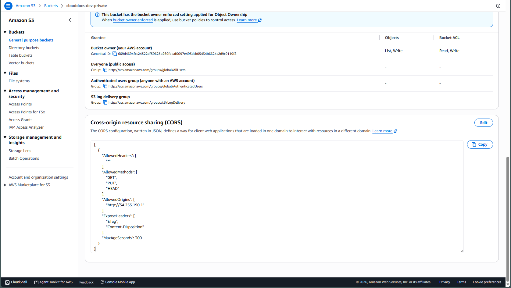
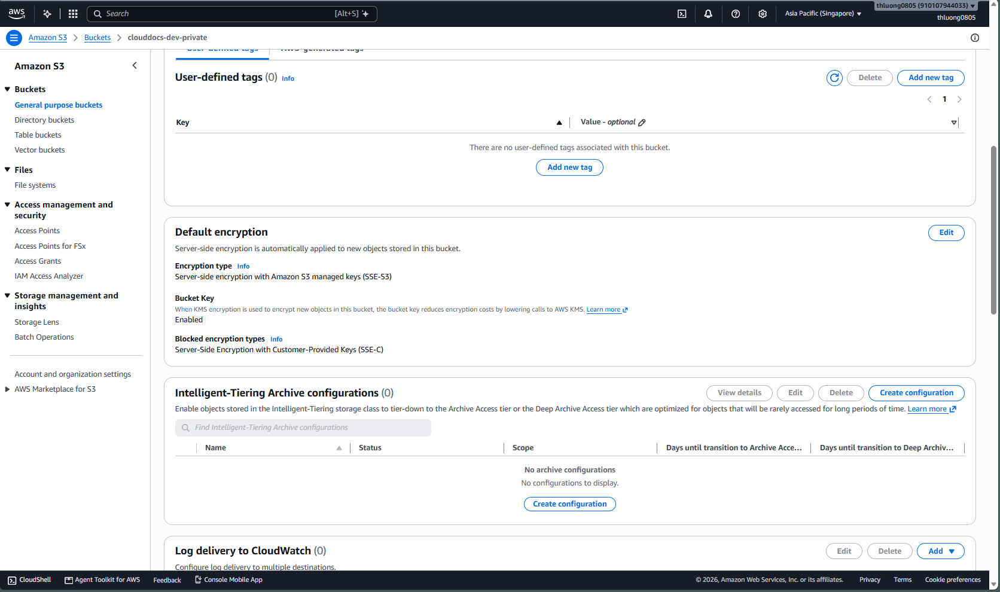
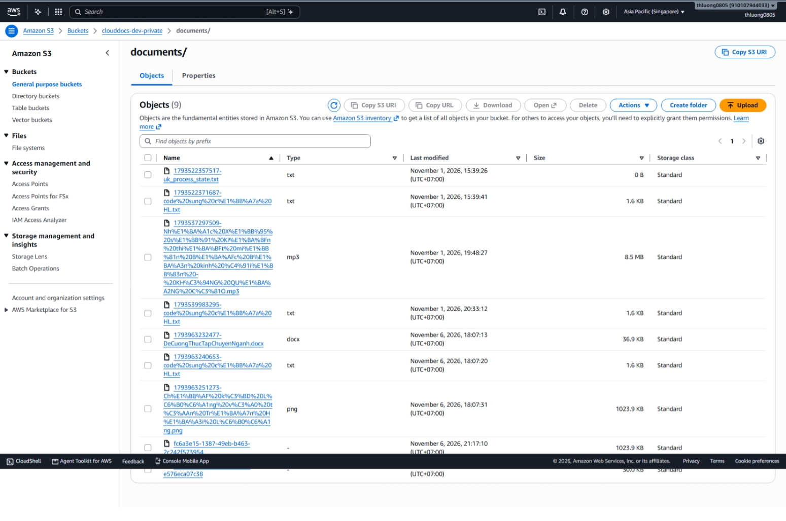
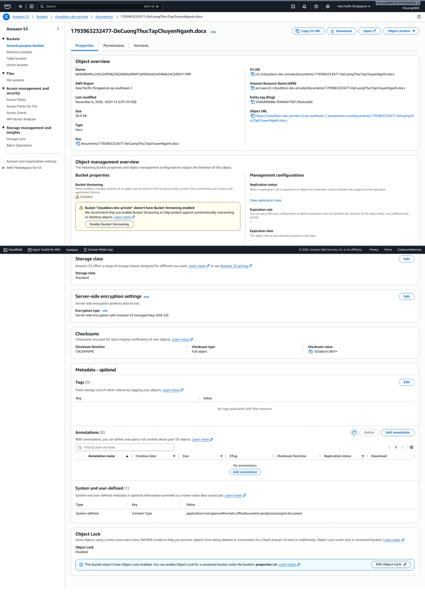

## 1. Tạo hoặc đối chiếu bucket

Trong S3 Console, chọn bucket dự án ở Region đã thống nhất, giữ **Block Public Access**, Object Ownership **Bucket owner enforced** và mã hóa mặc định. Nếu bucket đang dùng có dữ liệu, đối chiếu trước khi chỉnh sửa. Không bật public website cho bucket tài liệu.

Backend hiện sử dụng prefix documents/ và key UUID. Mẫu policy, CORS và script nằm trong Back_end/aws/s3; đây là công cụ thay đổi hạ tầng khi chạy, không phải bước khởi động ứng dụng bắt buộc.

## 2. CORS theo origin thật

Ví dụ nhập tại S3 Console → Permissions → CORS (thay origin):

~~~json
[
  {
    "AllowedHeaders": ["*"],
    "AllowedMethods": ["GET", "HEAD", "PUT"],
    "AllowedOrigins": ["https://YOUR_FRONTEND_HOST"],
    "ExposeHeaders": ["ETag"],
    "MaxAgeSeconds": 3600
  }
]
~~~

Trong Console nhập **mảng rule** như trên. File JSON dùng với AWS CLI có dạng object chứa CORSRules như mẫu repository. Nếu cần local, thêm đúng origin http://localhost:5500 hoặc http://127.0.0.1:5500 đang dùng. CORS không thay thế IAM và không tự làm bucket công khai.

## 3. Cấu hình backend

| Biến | Giá trị cần đặt |
| --- | --- |
| AWS_REGION | Region bucket thật |
| S3_BUCKET | Tên bucket của nhóm |
| S3_PRESIGN_EXPIRY | Thời gian giây; mặc định hiện có 900, có thể giảm theo nhu cầu |

## 4. Kiểm tra luồng chuẩn

1. Đăng nhập, tạo metadata qua POST /api/documents.
2. POST /api/documents/{id}/upload-url; không tự đoán trường JSON, dùng giao diện/DTO của phiên bản đang chạy.
3. Frontend PUT File tới URL S3, giữ nguyên header được ký.
4. POST /api/documents/{id}/upload-complete; backend HEAD object và xác nhận kích thước.
5. GET preview-url/download-url bằng tài khoản có quyền, mở URL mới được cấp.

**Kết quả mong đợi:** object private tồn tại, metadata xác nhận upload và tài khoản khác bị từ chối khi chưa được chia sẻ. URL ký trước có thể còn dùng được tới khi hết hạn; credential tạm hết hạn có thể làm URL hết hiệu lực sớm hơn.

## Lỗi thường gặp

403: kiểm tra principal ký, policy, prefix, Region, header và URL hết hạn. CORS: so origin đầy đủ scheme/host/port; test từ browser. Metadata đã tạo nhưng file thiếu: không coi upload hoàn tất; xử lý allocation chờ theo luồng ứng dụng.

Tham khảo [CORS](https://docs.aws.amazon.com/AmazonS3/latest/userguide/cors.html) và [presigned URL](https://docs.aws.amazon.com/AmazonS3/latest/userguide/using-presigned-url.html).

<!-- workshop-evidence -->

## Thực hành và kết quả minh họa

### H01. Bucket và Region

Mở S3 → Buckets. Bucket clouddocs-dev-private nằm tại Asia Pacific (Singapore), ap-southeast-1; dùng đúng Region này cho S3 client của backend.

### H02. Chặn truy cập công khai

Trong Permissions, Block all public access là On và Object Ownership là Bucket owner enforced. Tài liệu được truy cập qua quyền được cấp, không qua website public của bucket.

### H03. Bucket policy chéo tài khoản

Bucket policy cho phép CloudDocsEc2Role của tài khoản 861358180788 đọc, ghi và xóa object tại documents/*. Đối chiếu ARN role với T02/T05 và permission policy phía role; đây là truy cập bằng resource policy, không phải bằng chứng ứng dụng đã tự AssumeRole sang một role S3 khác.

### H04. CORS đã lưu

Trong Permissions → CORS, cấu hình đã lưu cho phép GET, PUT, HEAD từ http://54.255.190.1; ExposeHeaders gồm ETag và Content-Disposition, MaxAgeSeconds là 300. Đây là origin của lần chụp; nếu đổi host hoặc cổng frontend phải đồng bộ lại.

### H05. Mã hóa mặc định SSE-S3

Mở Properties → Default encryption. Encryption type là SSE-S3, sử dụng khóa do Amazon S3 quản lý; không mô tả cấu hình này thành SSE-KMS.

### H06. Object đã lưu trong documents/

Mở Objects → documents/ để đối chiếu tên key, loại tệp, kích thước và thời điểm cập nhật. Danh sách có cả key của dữ liệu thử cũ và mới; không suy ra tất cả object đều được tạo từ cùng một phiên bản ứng dụng.

### H07. Thuộc tính một object

Chọn tệp DeCuongThucTapChuyenNganh.docx → Properties. Ảnh ghi nhận key trong documents/, dung lượng 36.9 KB, Storage class Standard và SSE-S3; Bucket Versioning đang Disabled. Thuộc tính này bổ sung minh chứng lưu trữ cho danh sách H06.

