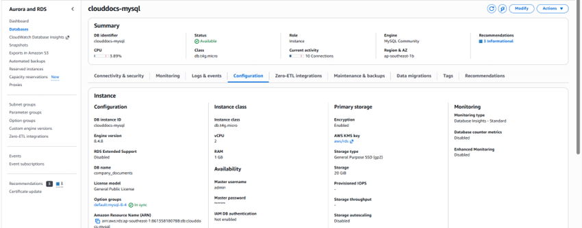
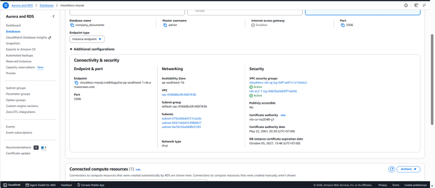
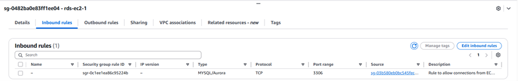
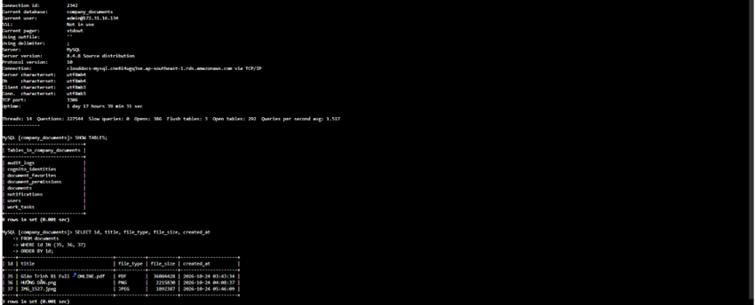

## 1. Prepare RDS

Create or verify a MySQL instance compatible with the application in the RDS Console. Select the prepared VPC/subnet group and database security group; configure storage, backup retention and password management for the environment. Describe a Single-AZ lab accurately rather than calling it Multi-AZ. Record the endpoint, port and schema name in configuration management.

## 2. Import the base schema

The repository **does not include a complete empty-database installer**. Use a verified schema export, check for sensitive data and import into a test database first. Base business tables such as users/documents/audit_logs must exist. Do not apply incremental migrations to an empty database or enable ddl-auto=update merely to bypass validation failures.

## 3. Review migrations

| Order | File in Back_end/db/migration | Purpose |
| --- | --- | --- |
| 0 | 00_PRECHECK.sql | Check legacy owner references |
| 1 | 01_APPLY_document_permissions.sql | owner_id and sharing permissions |
| 2 | 02_APPLY_document_favorites.sql | Favorites |
| 3 | 03_APPLY_notifications.sql | Global announcements |
| 4 | 04_APPLY_cognito_identities.sql | issuer/sub identity mapping |
| 5 | 05_APPLY_optional_contact_email.sql | Optional contact email |
| 6 | 06_APPLY_work_tasks.sql | Work tasks and recipient notifications; part of the November update |

Apply only missing steps after backing up and preflighting the correct database. Migration 04 and share-cognito-identities.sql are alternative ways to create the same table; do not run them consecutively. MySQL DDL may commit automatically, so ROLLBACK does not undo every ALTER/CREATE.

## 4. Connect the application

Set DB_HOST, DB_PORT, DB_NAME, DB_USERNAME and DB_PASSWORD outside source code. Give the application user only required privileges and keep it separate from the migration administrator.

**TLS:** the current application.yml contains a local JDBC URL with useSSL=false. For AWS, override SPRING_DATASOURCE_URL with an RDS JDBC URL using sslMode=VERIFY_IDENTITY and configure the correct RDS CA bundle/JVM truststore. Verify the SSL session; changing DB_HOST alone does not establish encryption.

## 5. Verification

Start the backend with the verified schema and confirm that ddl-auto=validate reports no missing tables/columns. Perform authorized test reads/writes, check metadata/audit and capture results with sensitive information hidden. Test backup restoration on a separate database before claiming recovery has been verified.

<!-- workshop-evidence -->

## Practice and illustrated results

### T07. RDS MySQL overview

Open RDS → Databases → clouddocs-mysql → Configuration. The screenshot shows Available status, MySQL Community, the db.t4g.micro class and the company_documents database. Compare these settings with the backend datasource configuration.

### T08. RDS endpoint and networking

In Connectivity & security, record the endpoint, port 3306, VPC, subnets and security groups. Publicly accessible is Yes in the screenshot, so this does not demonstrate the recommended private RDS setup described above. Actual reachability also depends on networking rules and routes.

### T09. Database security group MySQL rule

Open rds-ec2-1 → Inbound rules. The pictured rule accepts MySQL/Aurora TCP 3306 from an EC2 security group. Review the other groups attached to the database as well; one group screenshot does not describe all effective network permissions.

### T10. RDS connection and data query

In the MySQL client, inspect the connection to the RDS endpoint and the company_documents database. SHOW TABLES lists business tables including users, documents, document_permissions, audit_logs and work_tasks. SELECT id, title, file_type, file_size, created_at FROM documents WHERE id IN (35, 36, 37) ORDER BY id returns three document records, illustrating metadata reads from the database. These are the pictured test records and are not assumed to be the same file as H07. The connection information shows SSL: Not in use, so the screenshot demonstrates connectivity and querying, not the TLS configuration recommended above.

