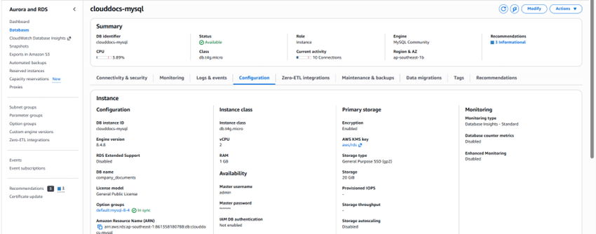
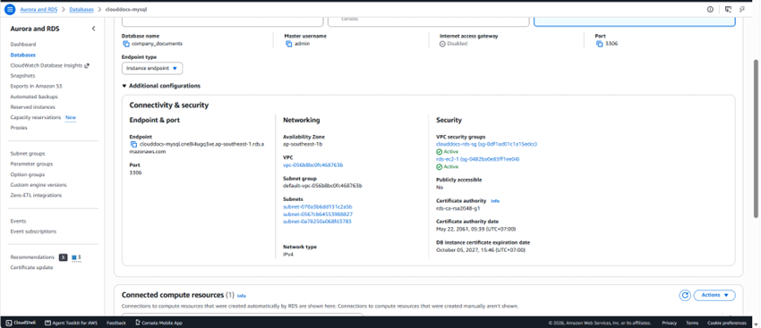
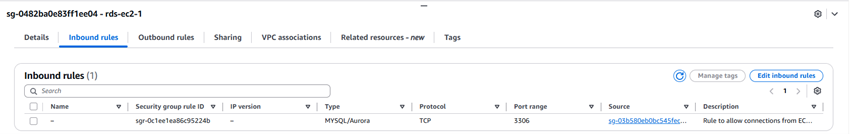
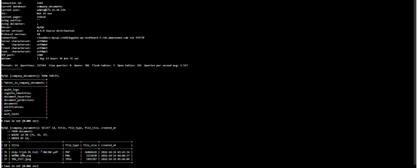

## 1. Chuẩn bị RDS

Trong RDS Console tạo/đối chiếu MySQL phù hợp với bản ứng dụng. Chọn VPC/subnet group và DB SG đã chuẩn bị; cấu hình storage, backup retention và quản lý mật khẩu theo môi trường. Đối với lab một DB Single-AZ, không ghi là Multi-AZ nếu chưa cấu hình. Ghi lại endpoint, port và schema name ở nơi quản lý cấu hình.

## 2. Import schema gốc

Repository hiện **không có bộ cài schema trống hoàn chỉnh**. Sử dụng bản export đã được kiểm tra nguồn gốc và schema, kiểm tra dữ liệu nhạy cảm và import vào DB thử trước. Các bảng nghiệp vụ nền như users/documents/audit_logs phải tồn tại. Không chạy migration tăng dần lên DB rỗng và không bật ddl-auto=update để né lỗi validate.

## 3. Rà soát migration

| Thứ tự | File trong Back_end/db/migration | Vai trò |
| --- | --- | --- |
| 0 | 00_PRECHECK.sql | Kiểm tra tham chiếu chủ sở hữu cũ |
| 1 | 01_APPLY_document_permissions.sql | owner_id và quyền chia sẻ |
| 2 | 02_APPLY_document_favorites.sql | Yêu thích |
| 3 | 03_APPLY_notifications.sql | Thông báo chung |
| 4 | 04_APPLY_cognito_identities.sql | Ánh xạ issuer/sub |
| 5 | 05_APPLY_optional_contact_email.sql | Email liên hệ tùy chọn |
| 6 | 06_APPLY_work_tasks.sql | Công việc và thông báo người nhận; thuộc bản cập nhật tháng 11 |

Chỉ áp dụng bước còn thiếu sau khi sao lưu và preflight đúng database. Migration 04 và share-cognito-identities.sql là hai cách tạo cùng bảng, không chạy nối tiếp. MySQL DDL có thể tự commit; không coi một ROLLBACK là hoàn tác toàn bộ ALTER/CREATE.

## 4. Kết nối ứng dụng

Đặt DB_HOST, DB_PORT, DB_NAME, DB_USERNAME, DB_PASSWORD ngoài mã nguồn. Chọn user ứng dụng có quyền cần thiết, tách khỏi user quản trị migration.

**TLS:** cấu hình application.yml hiện có chuỗi JDBC local chứa useSSL=false. Khi lên AWS, ghi đè SPRING_DATASOURCE_URL bằng JDBC URL của RDS dùng sslMode=VERIFY_IDENTITY và cấu hình truststore/CA bundle RDS phù hợp với JVM. Kiểm tra SSL session; không chỉ đổi DB_HOST rồi mặc định kết nối đã được mã hóa.

## 5. Kiểm tra

Khởi động backend bằng schema đã kiểm tra; xác nhận ddl-auto=validate không báo thiếu bảng/cột. Chạy đọc/ghi dữ liệu thử được phép, kiểm tra metadata/audit và chụp kết quả đã che thông tin nhạy cảm. Thử phục hồi backup trên DB riêng trước khi ghi là đã kiểm chứng khôi phục.

<!-- workshop-evidence -->

## Thực hành và kết quả minh họa

### T07. Tổng quan RDS MySQL

Mở RDS → Databases → clouddocs-mysql → Configuration. Ảnh thể hiện trạng thái Available, MySQL Community, lớp db.t4g.micro và database company_documents. Đối chiếu cấu hình này trước khi thiết lập datasource của backend.

### T08. Endpoint và mạng của RDS

Trong Connectivity & security, ghi nhận endpoint, cổng 3306, VPC, subnet và các Security Group. Publicly accessible trong ảnh đang là Yes; vì vậy đây chưa phải bằng chứng RDS private theo phương án khuyến nghị phía trên. Khả năng truy cập thực tế còn phụ thuộc các nhóm mạng và đường đi.

### T09. Quy tắc MySQL của DB Security Group

Mở nhóm rds-ec2-1 → Inbound rules. Quy tắc trong ảnh nhận MySQL/Aurora TCP 3306 từ một Security Group EC2. Cần rà soát cả các nhóm khác đang gắn với DB; một ảnh của một nhóm không đại diện toàn bộ quyền mạng.

### T10. Kết nối RDS và truy vấn dữ liệu

Trong MySQL client, kiểm tra thông tin kết nối tới endpoint RDS và database company_documents. SHOW TABLES hiển thị các bảng nghiệp vụ như users, documents, document_permissions, audit_logs và work_tasks. Truy vấn SELECT id, title, file_type, file_size, created_at FROM documents WHERE id IN (35, 36, 37) ORDER BY id trả về ba bản ghi tài liệu, minh họa việc đọc metadata từ cơ sở dữ liệu. Đây là các bản ghi thử trong ảnh, không mặc định cùng tệp ở H07. Thông tin phiên kết nối hiển thị SSL: Not in use; vì vậy ảnh này chứng minh kết nối và truy vấn, chưa chứng minh TLS đã được bật theo hướng dẫn phía trên.

