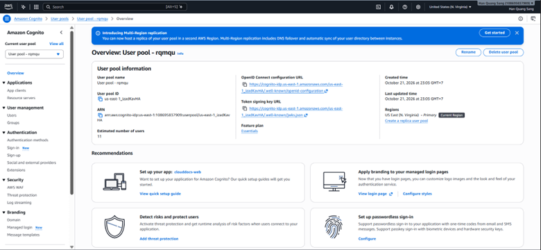
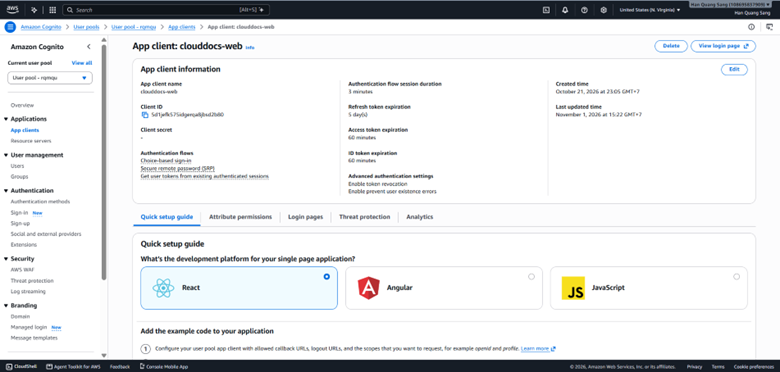
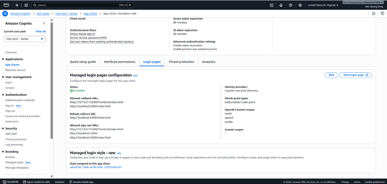
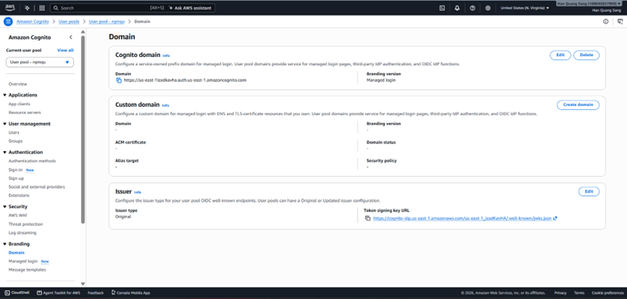
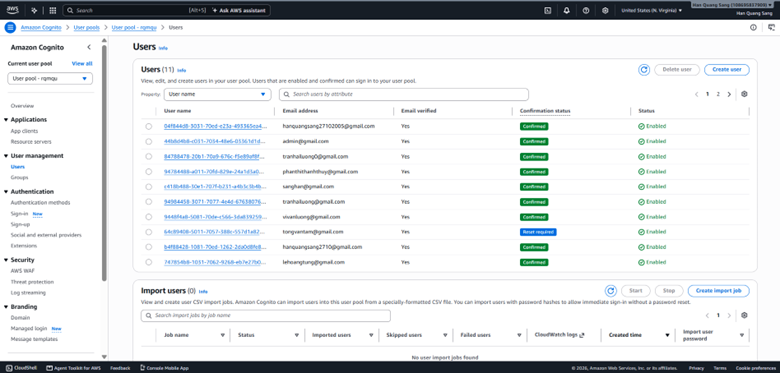

## 1. User Pool and public app client

Create or verify the User Pool, domain and web app client. Use a **public client without a client secret**, Authorization Code grant and PKCE. Callback/logout settings must exactly match actual URLs; use HTTPS for deployment. Select scopes appropriate to UserInfo, usually openid, profile and email according to the application. Do not enable unnecessary grants.

## 2. Consistent configuration

| Location | Configuration |
| --- | --- |
| FrontEnd/js/cognito-config.js | Domain, client ID, redirectUri/logoutUri and scopes using the actual file structure |
| Backend COGNITO_ISSUER_URI | Issuer https://cognito-idp.REGION.amazonaws.com/POOL_ID |
| Backend COGNITO_CLIENT_ID | Corresponding public app client ID |
| Backend COGNITO_USER_INFO_URI | UserInfo domain for the actual pool |
| Backend CORS_ALLOWED_ORIGINS | Actual frontend origin |

Do not copy the development issuer/client into another pool's configuration. Read the values assigned by local scripts rather than assuming externally supplied environment variables remain unchanged.

## 3. Backend validation and internal identities

The backend validates the JWT signature, issuer, validity period, token_use=access, client_id and sub. The system maps issuer/sub to a MySQL account and reads its current role/status. Email and full name are profile data, not substitutes for the identity key.

New accounts receive USER. Review Back_end/db/bootstrap-cognito-admin.sql to bootstrap the first ADMIN; do not arbitrarily edit shared database data. The template defaults to NULL targets/ROLLBACK so the operator can inspect it first.

## 4. Testing

Test sign-in, callback, GET /api/auth/me and logout. Missing, invalid or expired tokens must be rejected; USER must not call administrative APIs; locked/DELETED accounts must be denied business access. Logout does not instantly invalidate every access-token copy; document the actual behavior accurately.

See [Cognito PKCE](https://docs.aws.amazon.com/cognito/latest/developerguide/using-pkce-in-authorization-code.html).

<!-- workshop-evidence -->

## Practice and illustrated results

### S01. User Pool overview

Open Cognito → User pools → the application pool. Compare the Pool ID and us-east-1 Region when configuring the issuer; this Region differs from S3/RDS.

### S02. Frontend app client

Choose App clients → clouddocs-web. Client secret is shown as a dash, consistent with a client without a secret. The React selection in the Console quick-start guide does not establish the actual frontend technology used by the project.

### S03–S04. Callback, logout, grant and scopes

In Login pages, inspect callback/logout URLs, the Authorization code grant and email, openid and profile scopes. The screenshot records localhost/127.0.0.1 URLs for local use; deployment requires registering the actual frontend URLs. A grant configuration screenshot alone does not prove that the browser performed PKCE.

### S05. Sign-in domain

Open Branding → Domain and use the pool domain to synchronize the application authorize, token, UserInfo and logout configuration.

### S06. Cognito test users

Open Users to inspect accounts, Email verified, Confirmation status and Enabled status. CloudDocs ADMIN/USER roles are managed in application data and cannot be inferred from Cognito Confirmed status.

