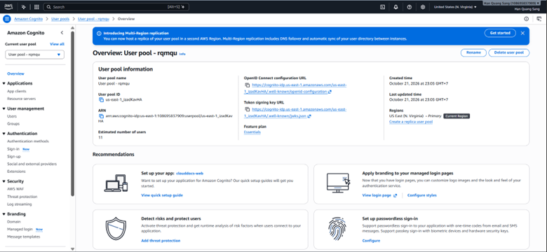
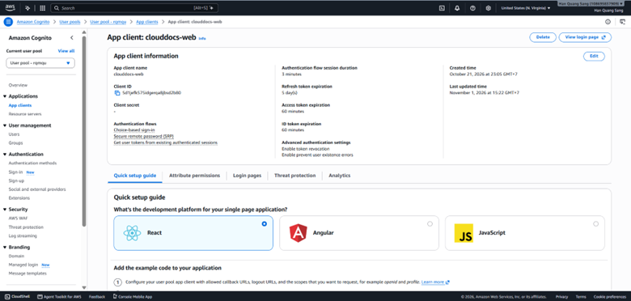
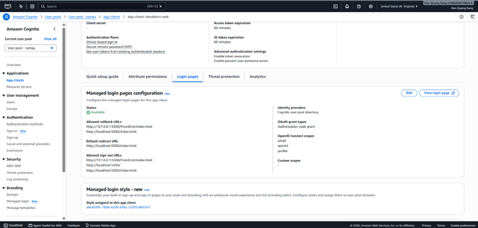
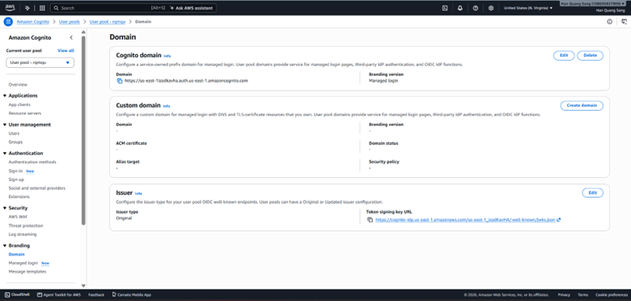
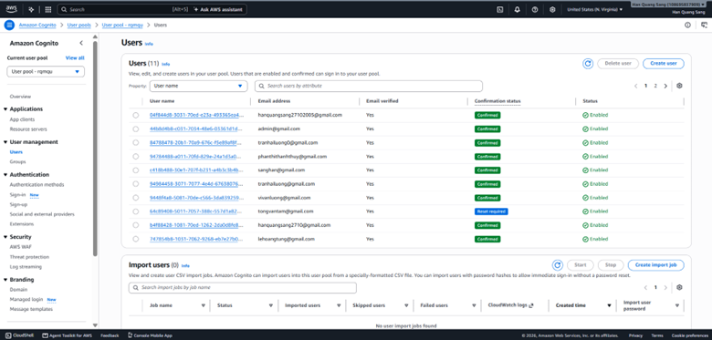

## 1. User Pool và public app client

Tạo/đối chiếu User Pool, domain và app client cho web frontend. Sử dụng **public client không có client secret**, Authorization Code grant và PKCE. Callback/logout phải khớp URL thực tế; dùng HTTPS khi triển khai. Chọn scope phù hợp luồng UserInfo, thường gồm openid, profile, email theo cấu hình ứng dụng. Không bật thêm grant ngoài nhu cầu.

## 2. Cấu hình đồng bộ

| Vị trí | Nội dung |
| --- | --- |
| FrontEnd/js/cognito-config.js | Domain, client ID, redirectUri/logoutUri, scope theo cấu trúc file thật |
| Backend COGNITO_ISSUER_URI | Issuer https://cognito-idp.REGION.amazonaws.com/POOL_ID |
| Backend COGNITO_CLIENT_ID | Public app client ID tương ứng |
| Backend COGNITO_USER_INFO_URI | Domain UserInfo của chính pool đang dùng |
| Backend CORS_ALLOWED_ORIGINS | Origin frontend thực tế |

Không sao chép issuer/client công khai của bản dev sang pool khác. Khi dùng script local cần đọc các giá trị script đang gán; không giả định biến môi trường ngoài script luôn được giữ nguyên.

## 3. Backend xác thực và danh tính nội bộ

Backend kiểm tra chữ ký JWT, issuer, thời gian hiệu lực, token_use=access, client_id và sub. Hệ thống ánh xạ issuer/sub với tài khoản MySQL, rồi đọc role/status hiện hành. Email và họ tên là dữ liệu hồ sơ, không thay thế khóa định danh.

Tài khoản mới là USER; bootstrap ADMIN đầu tiên theo template Back_end/db/bootstrap-cognito-admin.sql sau khi rà soát, không sửa trực tiếp dữ liệu trên DB dùng chung tùy tiện. Template mặc định có mục tiêu NULL/ROLLBACK để người vận hành kiểm tra trước.

## 4. Kiểm thử

Đăng nhập, callback, GET /api/auth/me, đăng xuất. Kiểm tra token thiếu/sai/hết hạn bị từ chối; USER không gọi được API quản trị; tài khoản khóa/DELETED không còn truy cập nghiệp vụ. Logout không làm mọi bản sao access token mất hiệu lực ngay; không mô tả khác khả năng hiện tại.

Tham khảo [Cognito PKCE](https://docs.aws.amazon.com/cognito/latest/developerguide/using-pkce-in-authorization-code.html).

<!-- workshop-evidence -->

## Thực hành và kết quả minh họa

### S01. Tổng quan User Pool

Mở Cognito → User pools → pool đang dùng. Đối chiếu Pool ID và Region us-east-1 để thiết lập issuer; Region này khác với S3/RDS.

### S02. App client của frontend

Chọn App clients → clouddocs-web. Ảnh thể hiện Client secret là dấu gạch, tương ứng client không có secret. Lựa chọn React trong trang hướng dẫn Console không xác định công nghệ frontend thực tế của dự án.

### S03–S04. Callback, logout, grant và scope

Trong Login pages, kiểm tra callback/logout, Authorization code grant và các scope email, openid, profile. Ảnh hiện ghi URL localhost/127.0.0.1 để chạy local; khi triển khai phải đăng ký đúng URL frontend. Ảnh cấu hình grant không tự chứng minh PKCE đã được thực hiện trong trình duyệt.

### S05. Domain đăng nhập

Mở Branding → Domain, lấy domain của pool để đồng bộ cấu hình authorize, token, UserInfo và logout của ứng dụng.

### S06. Người dùng thử trong Cognito

Mở Users để đối chiếu tài khoản, Email verified, Confirmation status và trạng thái Enabled. Role ADMIN/USER của CloudDocs được quản lý trong dữ liệu ứng dụng, không được suy ra từ trạng thái Confirmed của Cognito.

