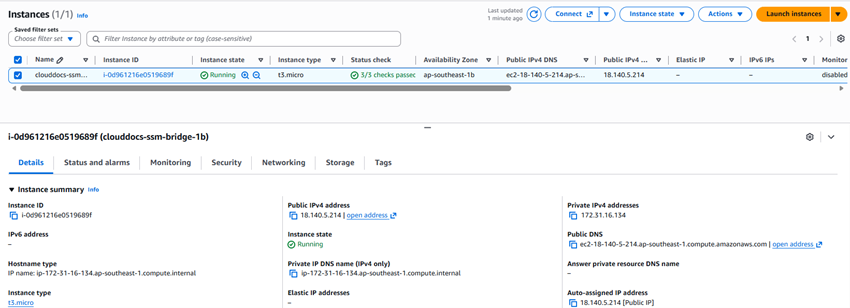
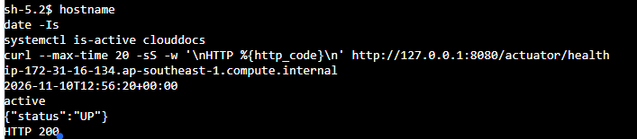

## 1. Prepare the server

Create or verify an appropriate Linux EC2 instance, S3 instance profile and network security group. Install Java 21 and Nginx using packages appropriate to the OS. Build the JAR in a verified environment and transfer it and FrontEnd to the server. The current frontend needs neither npm install nor npm build. Do not serve the entire repository through the web server.

## 2. Backend environment configuration

Keep configuration in an environment file readable only by the operator, outside the web root and repository. Minimum variables:

| Variable | Purpose |
| --- | --- |
| SPRING_PROFILES_ACTIVE=aws | Deployment profile |
| DB_HOST / DB_PORT / DB_NAME / DB_USERNAME / DB_PASSWORD | Database connection |
| SPRING_DATASOURCE_URL | TLS JDBC override described in the RDS section |
| AWS_REGION / S3_BUCKET / S3_PRESIGN_EXPIRY | Environment-specific S3 settings |
| COGNITO_ISSUER_URI / COGNITO_CLIENT_ID / COGNITO_USER_INFO_URI | Authentication against the correct pool |
| CORS_ALLOWED_ORIGINS | Frontend origin |
| PORT=8080 | Backend accessed only through the reverse proxy |

Replace paths and the actual JAR in this systemd example. Create the clouddocs system user first and grant it access to configuration and application files. An example JAR name is not a command that can be used unchanged in every environment.

~~~ini
[Unit]
Description=CloudDocs backend
After=network-online.target
Wants=network-online.target

[Service]
User=clouddocs
WorkingDirectory=/opt/clouddocs
EnvironmentFile=/etc/clouddocs/backend.env
ExecStart=/usr/bin/java -jar /opt/clouddocs/backend.jar
Restart=on-failure
RestartSec=5
SuccessExitStatus=143

[Install]
WantedBy=multi-user.target
~~~

Rename the tested deployment build to backend.jar and verify that /usr/bin/java is Java 21. Run systemctl daemon-reload and enable/start according to the administration procedure, then inspect journalctl -u clouddocs for errors. Keep passwords/tokens out of logs.

## 3. Serve the frontend and proxy with Nginx

Example **inside an HTTPS server with a valid certificate**; replace the domain, certificate and directories for the actual server:

~~~nginx
root /var/www/clouddocs;
index index.html;

location / {
    try_files $uri $uri/ =404;
}
location /api/ {
    proxy_pass http://127.0.0.1:8080;
    proxy_set_header Host $host;
    proxy_set_header X-Forwarded-Proto $scheme;
    proxy_set_header X-Forwarded-For $proxy_add_x_forwarded_for;
}
~~~

Copy the **contents of FrontEnd** into the web root in this example. If the callback uses /FrontEnd/, preserve that prefix in directory/Nginx configuration; changing Cognito alone is insufficient. Set API_BASE for the actual hostname/backend. Run nginx -t before reloading. Redirect port 80 to HTTPS according to environment policy; a domain/certificate is a prerequisite rather than an assumed existing resource.

## 4. Monitoring, backups and costs

Basic EC2 CloudWatch monitoring includes CPU, network and status checks. RAM, filesystem and application logs require the agent, permissions and suitable networking. Set retention, generate a controlled error and verify that its log arrives. Configure RDS backup/snapshot retention and test restoration on a copy. Set a budget with the appropriate account, recipient and threshold; Budgets is not a switch that automatically stops every resource.

Secrets Manager may be added later, but the application currently reads environment variables. Creating a secret does not automatically make Spring Boot retrieve it.

## 5. Deployment evidence

Record the EC2 instance, commit/JAR, deployment time, HTTPS URL, /api/health, RDS connection, S3 upload and Cognito sign-in. Use endpoints, hostnames and screenshots from the actual CloudDocs environment under test.

<!-- workshop-evidence -->

## Practice and illustrated results

### T01. EC2 in the practice environment

EC2 → Instances records clouddocs-ssm-bridge-1b as Running, with a t3.micro type and passed status checks. Its private DNS ip-172-31-16-134 matches the hostname in T06; the terminal check below adds evidence of the backend service running on this instance at capture time.

### T06. Running backend and health check

In the EC2 terminal session, run hostname and date -Is to record the host and verification time. systemctl is-active clouddocs returns active; curl to http://127.0.0.1:8080/actuator/health returns {"status":"UP"} and HTTP 200. Hostname ip-172-31-16-134 matches the private DNS in T01, providing evidence that the backend was running on this instance at capture time. The pictured endpoint is /actuator/health; this result does not replace sign-in, file transfer or external access tests.

