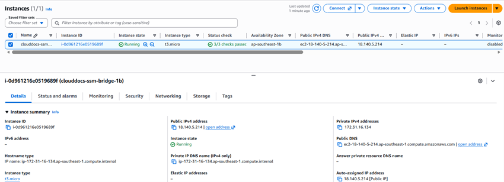
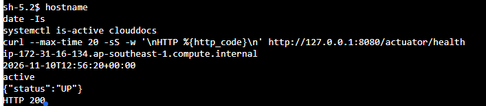

## 1. Chuẩn bị máy chủ

Khởi tạo/đối chiếu EC2 Linux phù hợp, instance profile truy cập S3 và SG của phần mạng. Cài Java 21 và Nginx bằng package phù hợp OS. Build JAR trên môi trường đã kiểm tra, chuyển JAR và thư mục FrontEnd tới máy chủ; frontend hiện không cần npm install hay npm build. Không phục vụ cả repository bằng web server.

## 2. Cấu hình môi trường backend

Đặt cấu hình trong file môi trường chỉ người vận hành đọc được, nằm ngoài web root và repository. Các biến tối thiểu:

| Biến | Mục đích |
| --- | --- |
| SPRING_PROFILES_ACTIVE=aws | Profile triển khai |
| DB_HOST / DB_PORT / DB_NAME / DB_USERNAME / DB_PASSWORD | Kết nối CSDL |
| SPRING_DATASOURCE_URL | JDBC TLS override theo phần RDS |
| AWS_REGION / S3_BUCKET / S3_PRESIGN_EXPIRY | S3 đúng môi trường |
| COGNITO_ISSUER_URI / COGNITO_CLIENT_ID / COGNITO_USER_INFO_URI | Xác thực đúng pool |
| CORS_ALLOWED_ORIGINS | Origin frontend |
| PORT=8080 | Backend chỉ phục vụ sau reverse proxy |

Mẫu service systemd dưới đây cần thay đường dẫn và JAR thật; tạo user hệ thống clouddocs trước, cho quyền đọc cấu hình và tệp ứng dụng. Không dùng tên JAR giả làm lệnh có thể chạy nguyên xi.

~~~ini
[Unit]
Description=CloudDocs backend
After=network-online.target
Wants=network-online.target

[Service]
User=clouddocs
WorkingDirectory=/opt/clouddocs
EnvironmentFile=/etc/clouddocs/backend.env
ExecStart=/usr/bin/java -jar /opt/clouddocs/backend.jar
Restart=on-failure
RestartSec=5
SuccessExitStatus=143

[Install]
WantedBy=multi-user.target
~~~

Đổi tên bản build đã kiểm tra thành backend.jar khi đóng gói triển khai, kiểm tra /usr/bin/java thực sự là Java 21. Dùng systemctl daemon-reload, enable/start theo quy trình quản trị, rồi xem journalctl -u clouddocs để tìm lỗi. Không ghi password/token trong log.

## 3. Nginx phục vụ frontend và proxy

Ví dụ **bên trong server HTTPS đã cấu hình chứng chỉ hợp lệ** (thay domain, certificate và thư mục theo máy thật):

~~~nginx
root /var/www/clouddocs;
index index.html;

location / {
    try_files $uri $uri/ =404;
}
location /api/ {
    proxy_pass http://127.0.0.1:8080;
    proxy_set_header Host $host;
    proxy_set_header X-Forwarded-Proto $scheme;
    proxy_set_header X-Forwarded-For $proxy_add_x_forwarded_for;
}
~~~

Copy **nội dung FrontEnd** vào web root ở ví dụ này. Nếu callback dùng prefix /FrontEnd/, cấu hình thư mục/Nginx phải bảo toàn prefix đó; không chỉ sửa Cognito một phía. Đặt API_BASE theo hostname/backend thật. Kiểm tra nginx -t trước reload. Cổng 80 chuyển hướng HTTPS theo chính sách môi trường; hướng dẫn này không giả định đã có tên miền/chứng chỉ.

## 4. Giám sát, sao lưu và chi phí

CloudWatch EC2 cơ bản có CPU/network/status checks; muốn RAM, filesystem và log ứng dụng cần cài/cấu hình agent, IAM và đường mạng phù hợp. Đặt retention, thử tạo một lỗi kiểm soát và kiểm tra log nhận được. RDS backup/snapshot cần theo retention thực tế và thử restore trên bản sao. Thiết lập ngân sách theo tài khoản được giao, ghi rõ người nhận và ngưỡng; không coi Budgets là công tắc tự dừng mọi tài nguyên.

Secrets Manager có thể bổ sung sau nhưng ứng dụng hiện đọc biến môi trường; tạo secret không tự khiến Spring Boot đọc secret đó.

## 5. Minh chứng triển khai

Ghi EC2 instance, commit/JAR, thời gian deploy, URL HTTPS, /api/health, kết nối RDS, upload S3 và đăng nhập Cognito. Dùng endpoint, hostname và ảnh của chính môi trường CloudDocs được kiểm tra.

<!-- workshop-evidence -->

## Thực hành và kết quả minh họa

### T01. EC2 trong môi trường thực hành

Ảnh EC2 → Instances ghi nhận máy clouddocs-ssm-bridge-1b đang Running, loại t3.micro và status checks đạt. Private DNS ip-172-31-16-134 trùng hostname trong T06; ảnh kiểm tra terminal bên dưới bổ sung bằng chứng dịch vụ backend hoạt động trên máy này tại thời điểm chụp.

### T06. Backend hoạt động và kiểm tra health

Trong phiên terminal trên EC2, chạy hostname và date -Is để ghi nhận máy và thời điểm kiểm tra. Lệnh systemctl is-active clouddocs trả active; yêu cầu curl tới http://127.0.0.1:8080/actuator/health trả {"status":"UP"} và HTTP 200. Hostname ip-172-31-16-134 khớp private DNS của máy trong T01, bổ sung bằng chứng backend đang chạy trên máy này tại thời điểm chụp. Endpoint được kiểm tra trong ảnh là /actuator/health; kết quả này không thay thế kiểm thử đăng nhập, truyền tệp hoặc truy cập từ bên ngoài.

