## Test prerequisites

Prepare at least one ADMIN and two active USER accounts linked to Cognito, an authorized small file, an empty file and an oversized file for rejection tests. Use test data and record the commit, environment, tester and time. The following table lists **scenarios and expected results**, not preassigned passing outcomes.

| ID | Scenario | Expected result |
| --- | --- | --- |
| AUTH-01 | Missing, invalid or expired access token | Business API rejects the request without exposing content |
| AUTH-02 | USER calls an administrative API | Access denied |
| DOC-01 | Create metadata, PUT to S3 and confirm upload | Object exists; metadata is correct and readable |
| DOC-02 | Concurrent uploads with identical filenames | Distinct object keys; no unintended overwrite |
| DOC-03 | Failed/missing PUT followed by confirmation | Missing object is not confirmed; allocation remains tracked |
| DOC-04 | Zero-byte file | Preview/download handles the file appropriately for its format |
| DOC-05 | File exceeds 100 MiB or the account quota | Rejected; allocations remain within the quota |
| ACL-01 | Grant VIEW to USER B | B can preview but cannot obtain download/edit access |
| ACL-02 | Grant DOWNLOAD/EDIT | Only the corresponding actions are allowed; sharing administration is not implied |
| ACL-03 | USER C has no share | API denies preview/download/edit |
| ACL-04 | Revoke B's permission | New URL requests are blocked; previously issued URLs may remain valid until expiration |
| TRASH-01 | Owner moves a file to trash | Preview/download/edit/share are blocked; quota still includes the file |
| TRASH-02 | Restore a file | Returns to ACTIVE and preserves earlier shares as designed |
| TRASH-03 | Permanently delete a test file | Object/permissions removed; metadata becomes PURGED with size 0; audit retained |
| BULK-01 | Select multiple files including one permission failure | Show individual success/failure and allow retrying failed items |
| QUOTA-01 | Pending uploads, trash and shared documents | Pending/trash count against the owner; sharing does not multiply allocation |
| AUDIT-01 | USER/ADMIN reads audit records | USER sees their own actor events; ADMIN sees system-wide events |
| TASK-01 | ADMIN assigns work; USER submits a valid document | Private notification and SUBMITTED/pending approval status |
| TASK-02 | Creator requests changes, then approves | Only authorized actor proceeds; feedback, audit and notifications recorded |
| TASK-03 | Submit after the deadline | Submission accepted and labeled late; reviewer delay does not make a pending approval overdue |
| TASK-04 | Two tabs use an outdated version | HTTP 409; user must reload current data |
| TASK-05 | Delete/overwrite a SUBMITTED/COMPLETED report file | API blocks the operation using the current release's guard |
| TASK-06 | Delete one or multiple tasks | Only the assigning ADMIN; retain documents/permissions/audit and handle related notifications |
| USER-01 | Delete an account with files or unfinished tasks | Blocked according to current conditions |

## Automated tests and limitations

In the CloudDocs repository, run mvn -f Back_end/pom.xml test and node --test FrontEnd/tests/*.test.cjs. Tests using mock repositories/AWS clients do not verify live RDS migrations, row locking, Cognito redirects, S3 CORS or browser PDF rendering. Record results for each test execution.

<!-- workshop-evidence -->

## Practice and illustrated results

### K01. Application after sign-in

After sign-in, the Overview page displays the admin account and application navigation. This illustrates access to CloudDocs; authentication configuration is documented in the Cognito section.

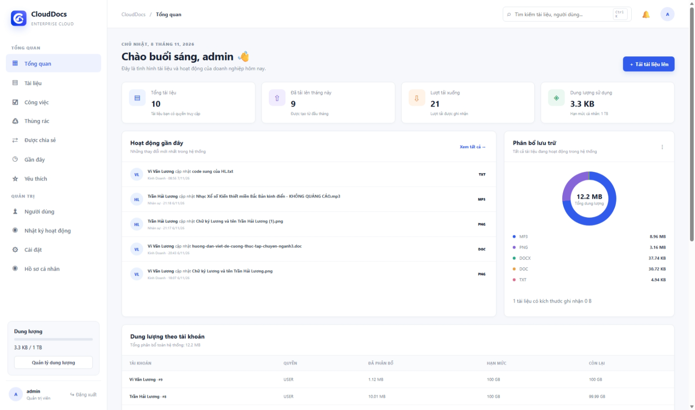

### K02a. Document upload

Choose Upload document, submit a test file and inspect the resulting list. The screenshot shows a notification that one document was saved successfully.

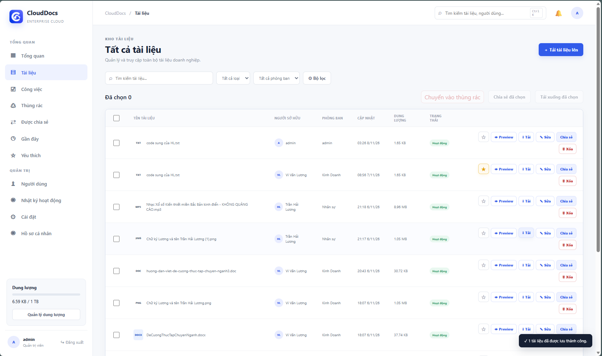

### K02b. File preview

Select Preview for the TXT test file. Its contents appear in the application preview dialog.

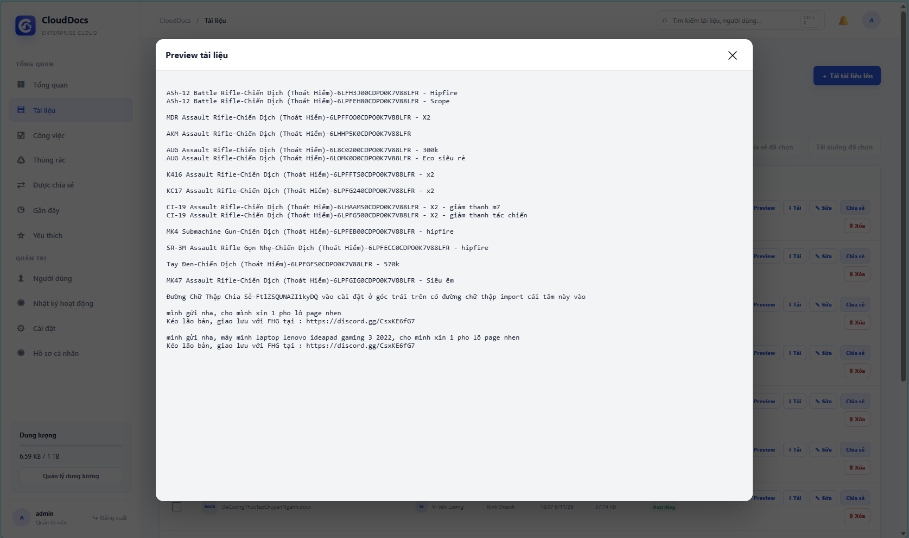

### K02c. File download

Select Download and inspect the browser downloads list. The downloaded TXT file appears alongside the CloudDocs download notification.

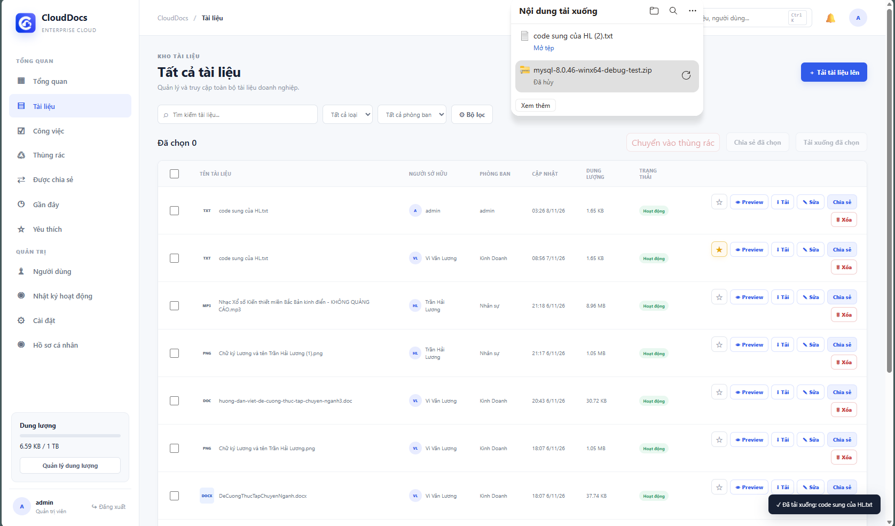

### K03. Shared documents

Sign in as an employee and open Shared with me. Rows expose different controls: Preview only or additional Download/Edit actions. This illustrates UI permissions; API denial checks follow the scenarios above.

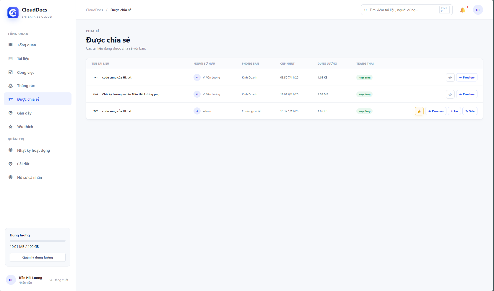

### K04. Document in the trash

Move the PDF to the trash and open Trash. The screenshot shows the document, deletion time, Restore and Permanently delete controls.

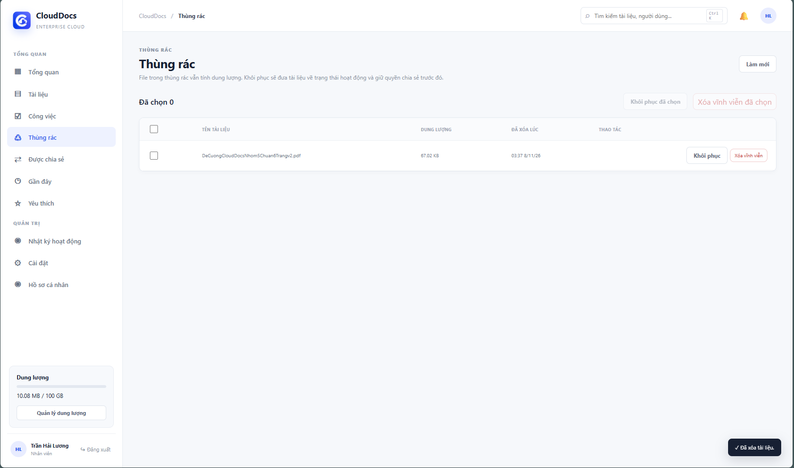

### K05. Document restored

Restore the file from K04 and return to Documents. The same PDF appears as Active with a successful 1/1 restore notification.

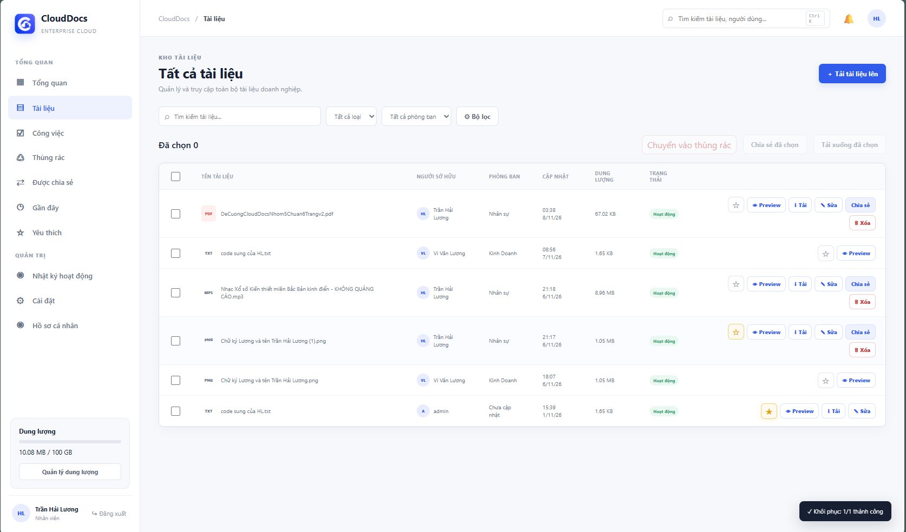

### K06. Assigned task details

Open task details to inspect the assignee, assigner, deadline and requirements. K06 shows VCB 111 with test data; it is a separate creation example, not the VCB 4123 task in K07–K08.

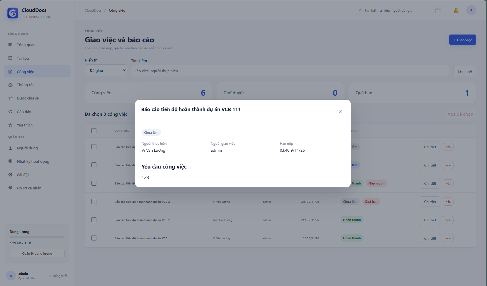

### K07. Report awaiting review

After an employee submits the test attachment for VCB 4123, the administrator opens its details to see Awaiting review status, the attachment, submission time and review controls.

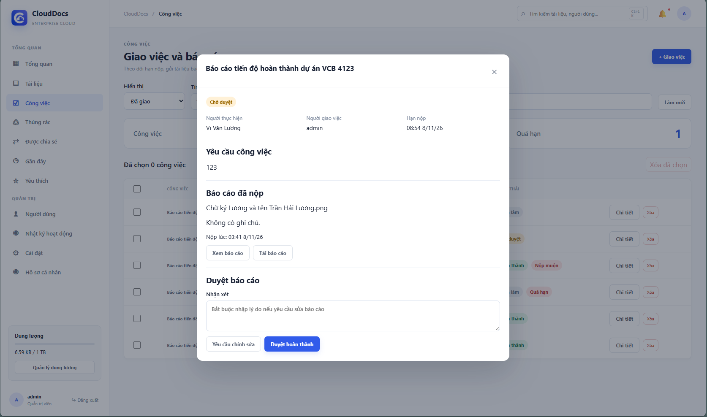

### K08. Report review result

Approve the same task shown in K07. Its status changes to Completed and a confirmation appears; the pair illustrates the submission-to-approval transition.

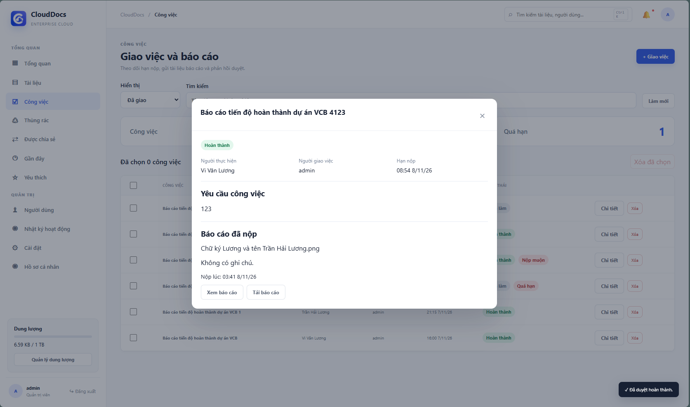

### K09. User management

Sign in as admin and open Users to inspect accounts, departments, roles and status. Role/status controls are displayed for each row.

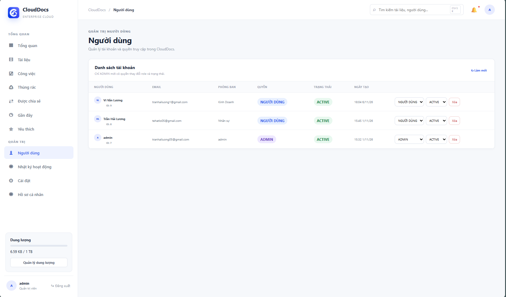

### K10a. Storage management overview

Sign in as admin and open Storage management. The screenshot records 12.27 MB used against the displayed 1 TB quota, 1.65 KB in the trash, a file-type breakdown and documents sorted by size. These are application statistics at capture time, not an Amazon S3 service limit.

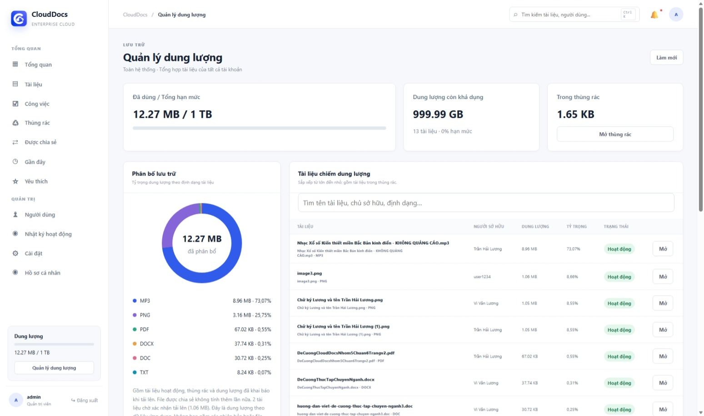

### K10b. Storage usage by account

Scroll to Storage usage by account to compare names, roles, usage, quotas and utilization. The screenshot shows 100 GB quotas for users and 1 TB for admin accounts; trashed documents remain in the allocation list above.

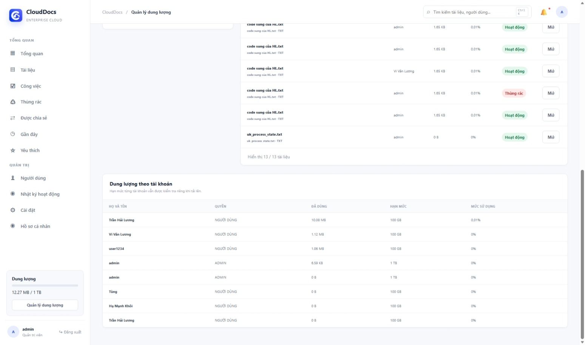

### K11. Activity log

Open Activity log. The screenshot records actors and timestamps for upload, deletion, restore, report submission and approval, which can be compared with K04–K08.

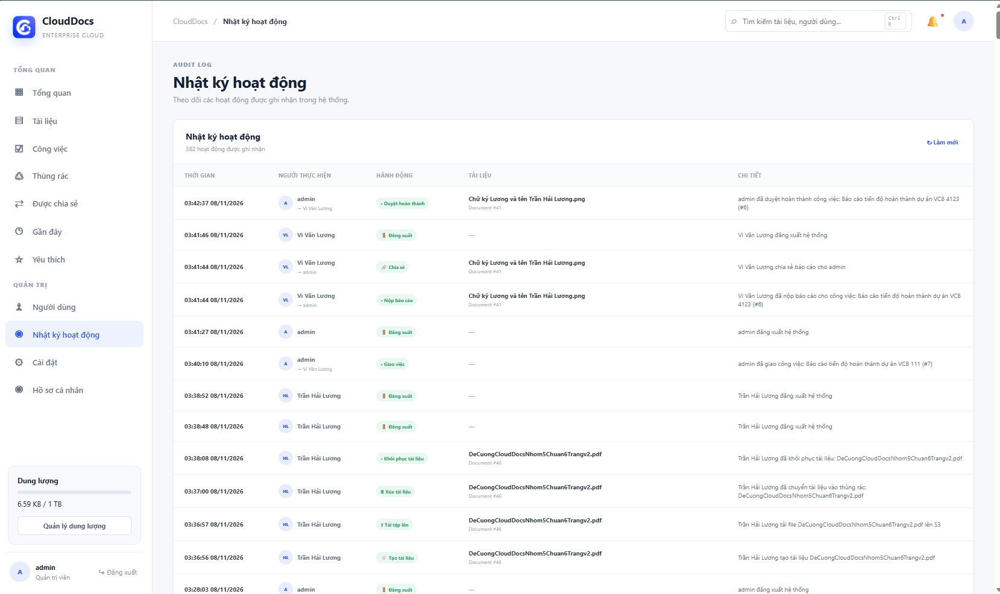

### K12. Document search

Enter DeCuong in document search. Two matching filenames appear. The screenshot illustrates filename search, not filtering by file type or department.

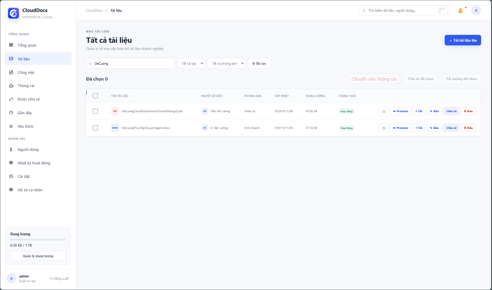
