## Điều kiện kiểm thử

Ít nhất một ADMIN, một MANAGER đã gán phòng ban và hai USER đang hoạt động đã liên kết Cognito; bố trí tài khoản cùng/khác phòng ban, tệp nhỏ được phép dùng, một file rỗng và một file quá giới hạn để thử từ chối. Dùng dữ liệu thử, ghi commit, môi trường, người chạy và thời điểm. Bảng sau là **kịch bản/kết quả mong đợi**, không phải bảng PASS sẵn.

| Mã | Kịch bản | Kết quả mong đợi |
| --- | --- | --- |
| AUTH-01 | Không gửi/sai/hết hạn access token | API nghiệp vụ từ chối, không lộ nội dung |
| AUTH-02 | USER gọi API quản trị | Bị từ chối |
| DOC-01 | Gửi multipart qua POST /api/documents/upload | Backend lưu/xác nhận S3 trước khi commit; metadata đúng và đọc lại được |
| DOC-02 | Upload trùng tên cùng lúc | Object key khác nhau, không ghi đè nhầm |
| DOC-03 | S3 upload/xác nhận lỗi trong giao dịch | Rollback metadata; thử dọn object của lần tải, ghi log nếu không dọn được |
| DOC-04 | File 0 byte | Preview/download xử lý hợp lệ theo định dạng |
| DOC-05 | File >100 MiB hoặc vượt quota | Bị từ chối; kiểm tra cấp phát không vượt hạn mức |
| DOC-06 | Mất phản hồi sau upload thành công, thử lại cùng requestId/tệp | Nhận tài liệu đã lưu, không tạo thêm bản trùng |
| DOC-07 | Ghi đè tệp có quyền EDIT và không bị bảo vệ | Giữ ID/chủ sở hữu/quyền/yêu thích; nội dung và dung lượng cập nhật |
| ACL-01 | Chia sẻ VIEW cho USER B | B xem trước được, không được cấp download/edit |
| ACL-02 | Chia sẻ DOWNLOAD/EDIT | Cho phép đúng thao tác; không tự có quyền quản lý chia sẻ |
| ACL-03 | USER C không được chia sẻ | Không xem/tải/sửa được qua API |
| ACL-04 | Thu hồi quyền B | Yêu cầu cấp URL mới bị chặn; ghi nhận URL cũ còn hiệu lực tới expiry |
| ACL-05 | MANAGER truy cập tài liệu chủ sở hữu cùng/khác phòng | Chỉ thêm quyền xem cùng phòng; không tự có quyền tải/sửa/chia sẻ/xóa |
| ACL-06 | Đổi/thu hồi một hoặc nhiều quyền tại Đã chia sẻ | Chỉ chủ sở hữu/ADMIN quản lý; quyền mới có hiệu lực ở yêu cầu API tiếp theo |
| FOLDER-01 | Tạo thư mục con, chuyển một/nhiều tệp của mình | Đúng cây thư mục; giữ S3 key, quyền chia sẻ và yêu thích |
| FOLDER-02 | USER/MANAGER sắp xếp tệp hoặc thư mục của người khác | Bị từ chối dù có quyền xem tài liệu |
| FOLDER-03 | Xóa cây thư mục có báo cáo đang được bảo vệ | Hủy toàn bộ thao tác, không chuyển một phần tệp vào thùng rác |
| TRASH-01 | Chủ sở hữu đưa file vào thùng rác | Chặn preview/download/edit/share, vẫn tính quota |
| TRASH-02 | Khôi phục | Trở về ACTIVE và giữ quyền chia sẻ cũ theo thiết kế |
| TRASH-03 | Xóa vĩnh viễn tệp thử | Xóa object/quyền, metadata PURGED size 0, giữ audit |
| BULK-01 | Chọn nhiều file có một lỗi quyền | Hiển thị thành công/thất bại từng file; xử lý lại phần lỗi |
| QUOTA-01 | Upload thành công/thất bại, trash và tài liệu được chia sẻ | Upload rollback không tăng dung lượng đã commit; trash vẫn tính cho chủ; chia sẻ không nhân dung lượng |
| AUDIT-01 | USER/ADMIN đọc nhật ký | USER chỉ audit do mình thực hiện; ADMIN xem toàn hệ thống |
| TASK-01 | ADMIN giao việc, USER nộp tài liệu hợp lệ | Thông báo riêng, trạng thái SUBMITTED/chờ duyệt |
| TASK-02 | Người giao yêu cầu sửa rồi duyệt | Đúng người có quyền; lưu feedback, audit và thông báo |
| TASK-03 | Nộp sau hạn | Được nộp và có nhãn nộp muộn; chờ duyệt không bị tính quá hạn do người duyệt chậm |
| TASK-04 | Hai tab dùng version cũ | Từ chối 409, yêu cầu tải lại dữ liệu |
| TASK-05 | Xóa/ghi đè file đang là báo cáo SUBMITTED/COMPLETED | API chặn theo guard của phiên bản hiện tại |
| TASK-06 | Xóa một/nhiều công việc | Chỉ ADMIN/MANAGER người giao; giữ tài liệu/quyền/audit, thông báo liên quan được xử lý |
| TASK-07 | MANAGER giao việc cùng/khác phòng ban | Chỉ giao cho USER hoạt động cùng phòng; không giao cho MANAGER khác |
| USER-01 | Xóa tài khoản còn tệp hoặc công việc chưa xong | Bị chặn theo điều kiện hiện hành |
| DEPT-01 | USER/MANAGER gọi API quản lý phòng ban hoặc đổi vai trò | Bị từ chối; ADMIN quản lý theo ràng buộc dữ liệu |
| UI-01 | Tìm/lọc/sắp xếp và chọn tất cả khi có hơn 20 mục | Phân trang dữ liệu phía trình duyệt; chỉ chọn dòng hợp lệ trên trang hiện tại |

## Kết quả thực tế và phạm vi minh chứng

Bảng dưới tổng hợp những gì minh chứng đang lưu thể hiện và phần còn cần kiểm tra. Các ảnh ghi nhận từng thời điểm, không đủ để xác nhận tất cả cùng một commit hoặc chứng minh mọi kịch bản ở trên đã PASS. Nội dung phiên bản hiện tại được đối chiếu với mã nguồn CloudDocs ngày 16/11/2026; chưa có kết quả chạy bộ kiểm thử gắn với commit/JAR nghiệm thu trong bộ minh chứng này.

| Hạng mục | Kết quả ghi nhận | Minh chứng / giới hạn |
| --- | --- | --- |
| EC2 và backend | Instance Running; dịch vụ active, health trả UP/HTTP 200 | T01, T06; kiểm tra trên máy, chưa xác nhận toàn bộ luồng từ bên ngoài |
| RDS MySQL | Kết nối và truy vấn metadata thành công | T07–T10; Publicly accessible = Yes, SSL: Not in use trong ảnh; chưa đạt cấu hình private/TLS khuyến nghị |
| S3 riêng tư | Chặn public, SSE-S3 và có object trong documents/ | H01–H07; chưa đối chiếu cùng một tệp xuyên suốt DB/S3/giao diện |
| Đăng nhập và thao tác tài liệu | Có phiên admin; ảnh tải lên, xem trước TXT và tải xuống | K01, K02a–K02c; chưa chứng minh cơ chế upload mới hoặc thử lại requestId trên bản triển khai |
| Chia sẻ, thùng rác và khôi phục | Có giao diện quyền khác nhau; cùng tệp chuyển vào thùng rác rồi khôi phục | K03–K05; từ chối API và URL sau thu hồi cần kiểm thử riêng |
| Nộp và duyệt báo cáo | Cùng công việc chuyển Chờ duyệt → Hoàn thành; danh sách bổ sung có nhãn Nộp muộn | K07–K08, K18; chưa minh họa chuỗi yêu cầu sửa/nộp lại, đối chiếu thời gian nộp hoặc xung đột hai tab |
| Quản trị, dung lượng, audit, tìm kiếm | Có màn hình người dùng, thống kê, lịch sử và tìm theo tên | K09–K12; số liệu là dữ liệu tại thời điểm chụp |
| Phòng ban và hồ sơ | Hiển thị danh sách phòng ban đang sử dụng; hồ sơ admin có avatar và các trường cập nhật | K13, K17; chưa có cặp ảnh trước/sau thao tác thêm/sửa/ngừng sử dụng hoặc lưu hồ sơ |
| Thư mục và Đã chia sẻ | Thư mục 123 chứa ba tài liệu; danh sách có bốn quyền chia sẻ cho hai người nhận | K14–K15; chưa xác minh di chuyển giữ nguyên quyền hoặc kết quả đổi/thu hồi quyền |
| Ghi đè nội dung | Hộp sửa tài liệu có vùng chọn tệp thay thế và hướng dẫn bảo vệ báo cáo | K16; chưa có kết quả lưu hoặc đối chiếu nội dung trước/sau ghi đè |
| MANAGER và kiểm soát quyền | Đã có triển khai và các tệp kiểm thử tương ứng trong mã nguồn | K13–K18 đều ở phiên admin; cần kiểm thử cùng/khác phòng ban bằng MANAGER/USER |
| HTTPS, giám sát, phục hồi và chi phí | Đã có hướng dẫn và kế hoạch vận hành | Chưa có kết quả nghiệm thu HTTPS, CloudWatch, restore hoặc hóa đơn trong bộ minh chứng hiện có |

Kết quả hiện có minh họa được các chức năng nghiệp vụ cốt lõi và từng thành phần AWS. Để nghiệm thu phiên bản mới, cần ghi commit/JAR và chạy lại kịch bản trên cùng môi trường; bổ sung kết quả thực đo thay vì suy ra từ ảnh của phiên bản trước.

## Kiểm thử tự động và giới hạn

Trong repository CloudDocs: mvn -f Back_end/pom.xml test; node --test FrontEnd/tests/*.test.cjs. Kiểm thử dùng mock repository/AWS client không xác nhận migration RDS, khóa dòng, redirect Cognito, CORS S3 hay PDF trong trình duyệt. Kết quả được ghi nhận theo từng lần chạy kiểm thử.

<!-- workshop-evidence -->

## Thực hành và kết quả minh họa

### K01. Giao diện sau đăng nhập

Sau khi đăng nhập, trang Tổng quan hiển thị tài khoản admin và menu ứng dụng. Ảnh minh họa phiên đã vào CloudDocs; cấu hình xác thực được đối chiếu tại mục Cognito.

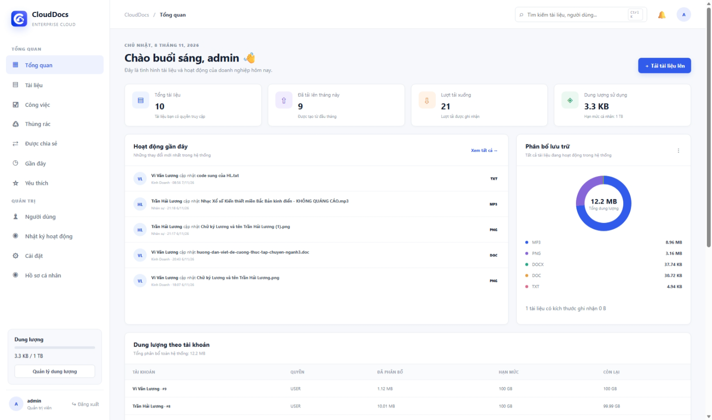

### K02a. Tải tài liệu lên

Chọn Tải tài liệu lên, gửi tệp thử và kiểm tra danh sách sau khi lưu. Ảnh có thông báo một tài liệu đã được lưu thành công.

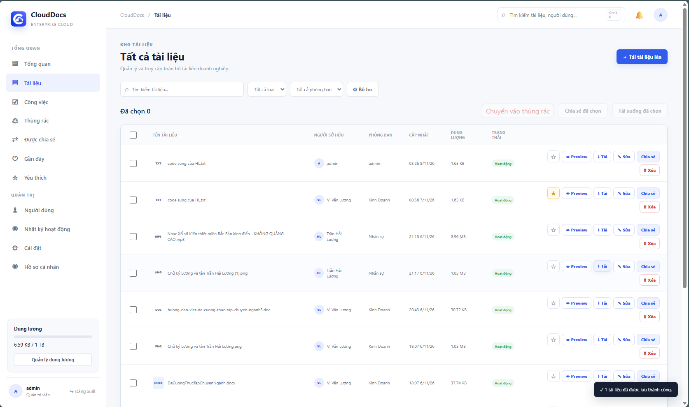

### K02b. Xem trước nội dung

Chọn Preview trên tệp TXT. Nội dung tệp thử hiển thị trong hộp xem trước của ứng dụng.

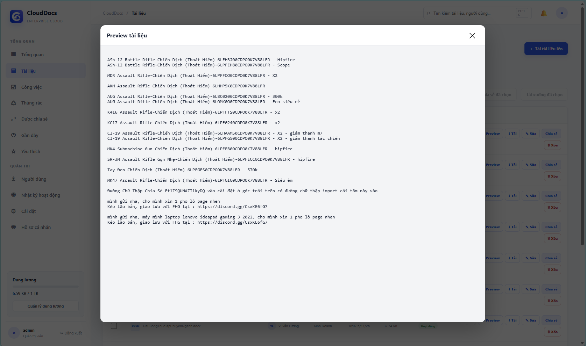

### K02c. Tải xuống

Chọn Tải và kiểm tra danh sách tải của trình duyệt. Tệp TXT đã tải xuất hiện cùng thông báo tải xuống của CloudDocs.

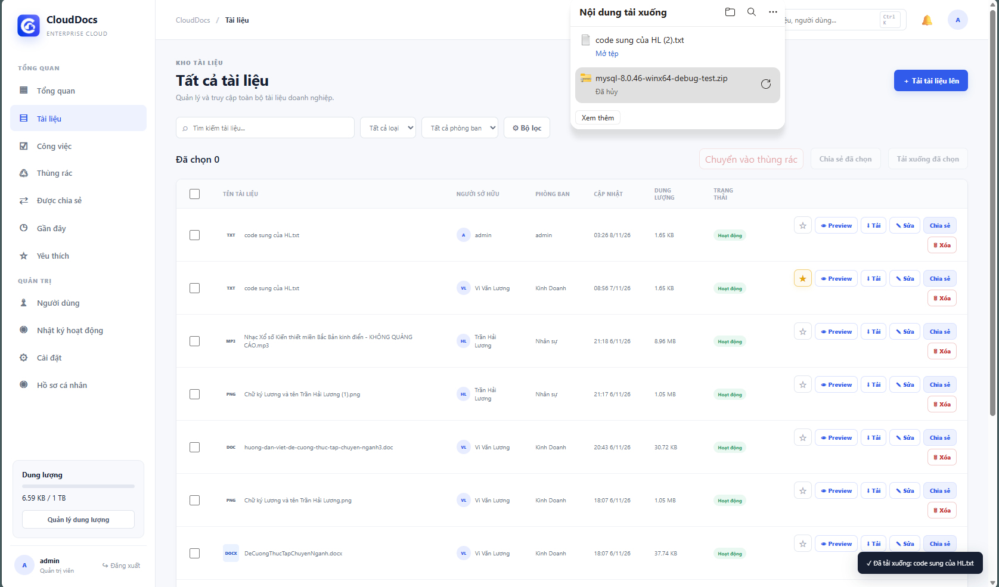

### K03. Tài liệu được chia sẻ

Đăng nhập bằng tài khoản nhân viên, mở Được chia sẻ. Các dòng hiển thị bộ nút khác nhau: chỉ Preview hoặc thêm Tải/Sửa, minh họa quyền tại giao diện; kiểm thử từ chối API được thực hiện theo bảng kịch bản bên trên.

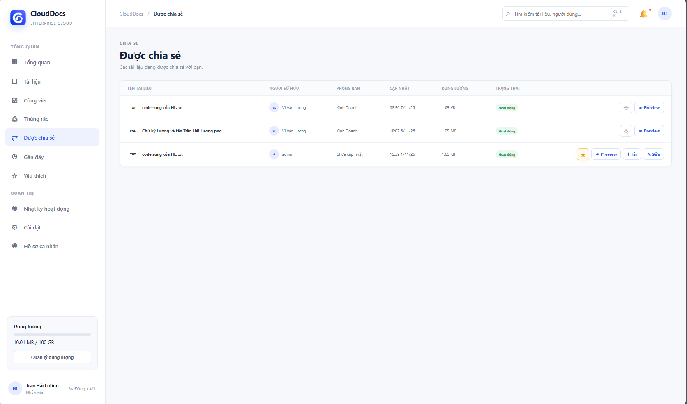

### K04. Tài liệu trong thùng rác

Xóa mềm tệp PDF và mở Thùng rác. Ảnh hiển thị tài liệu, thời điểm xóa cùng nút Khôi phục và Xóa vĩnh viễn.

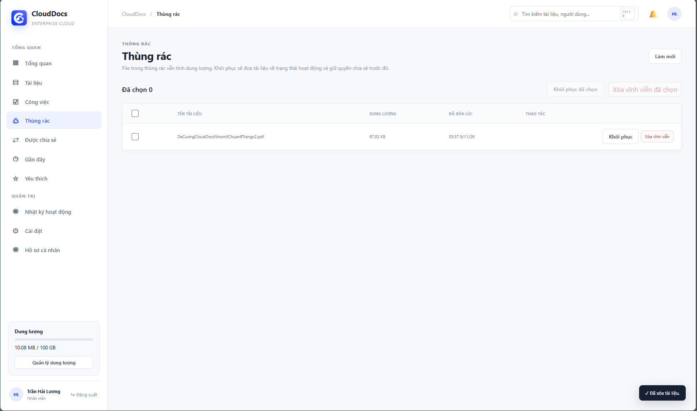

### K05. Khôi phục tài liệu

Khôi phục tệp ở K04 rồi quay lại Tài liệu. Cùng tệp PDF xuất hiện ở trạng thái Hoạt động, kèm thông báo khôi phục 1/1 thành công.

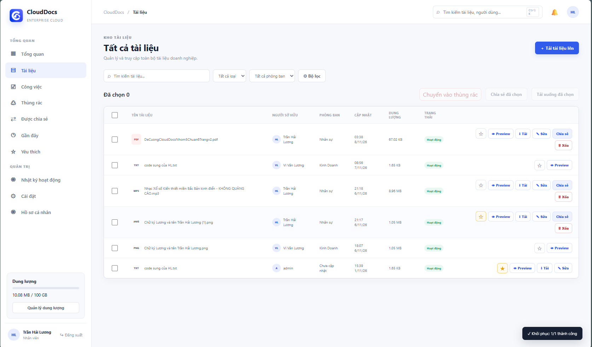

### K06. Chi tiết công việc được giao

Mở chi tiết công việc để xem người thực hiện, người giao, hạn nộp và yêu cầu. K06 là công việc VCB 111 với dữ liệu thử; đây là ví dụ tạo việc riêng, không phải công việc VCB 4123 ở cặp K07–K08.

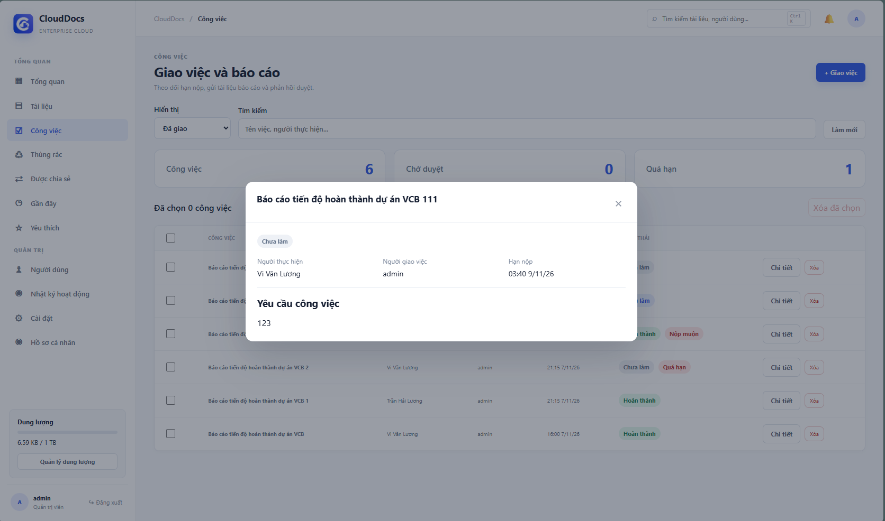

### K07. Báo cáo chờ duyệt

Sau khi nhân viên nộp tệp thử cho VCB 4123, quản trị viên mở chi tiết để xem trạng thái Chờ duyệt, tệp đính kèm, thời gian nộp và các nút phản hồi.

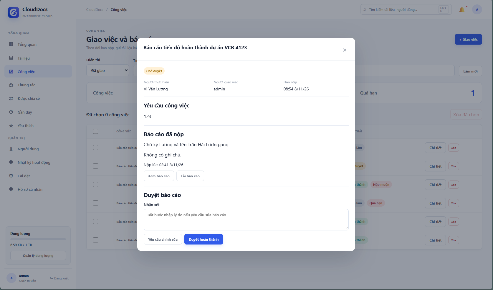

### K08. Kết quả duyệt báo cáo

Duyệt hoàn thành chính công việc ở K07. Trạng thái chuyển sang Hoàn thành và thông báo xác nhận xuất hiện; cặp ảnh minh họa chuyển trạng thái nộp → duyệt.

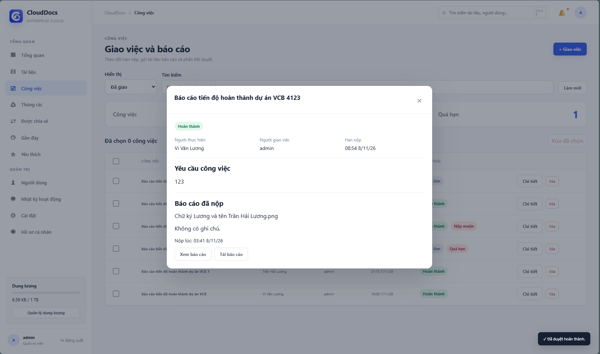

### K09. Quản lý người dùng

Đăng nhập admin, mở Người dùng để đối chiếu danh sách tài khoản, phòng ban, role và trạng thái. Các lựa chọn thay đổi quyền/trạng thái hiển thị tại từng dòng.

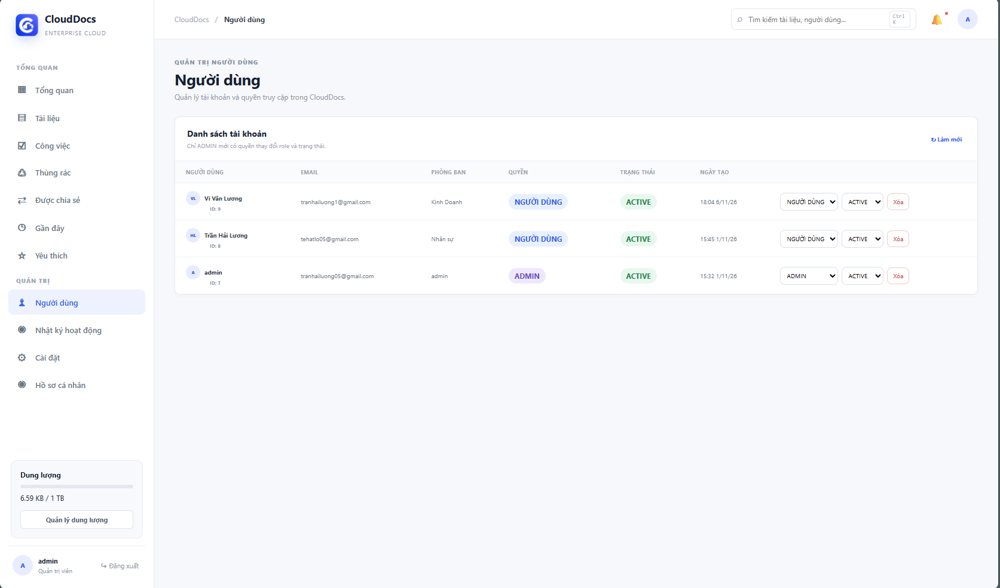

### K10a. Tổng quan quản lý dung lượng

Đăng nhập admin và mở Quản lý dung lượng. Ảnh ghi nhận tổng đã dùng 12.27 MB trên hạn mức hiển thị 1 TB, dung lượng trong thùng rác 1.65 KB, biểu đồ phân bố theo loại và danh sách tài liệu sắp xếp theo dung lượng. Đây là thống kê của ứng dụng tại thời điểm chụp, không phải hạn mức dịch vụ Amazon S3.

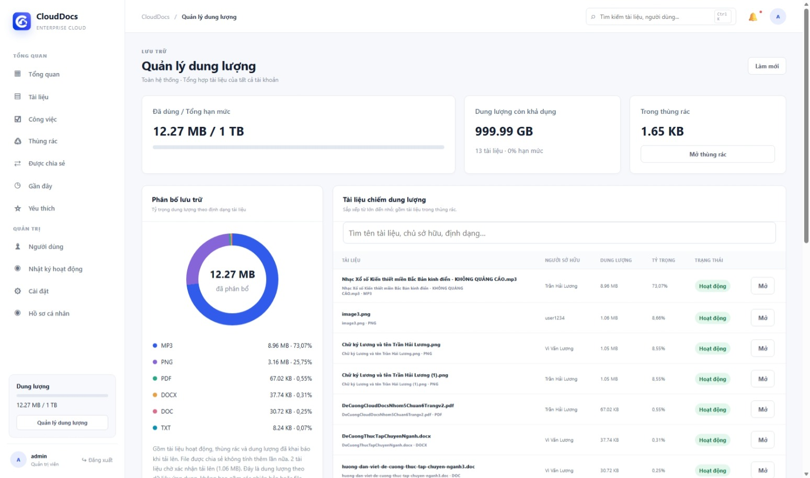

### K10b. Dung lượng theo tài khoản

Cuộn xuống bảng Dung lượng theo tài khoản để đối chiếu họ tên, quyền, đã dùng, hạn mức và mức sử dụng. Ảnh hiển thị hạn mức 100 GB cho người dùng và 1 TB cho admin; tài liệu trong thùng rác vẫn có mặt trong danh sách phân bổ phía trên.

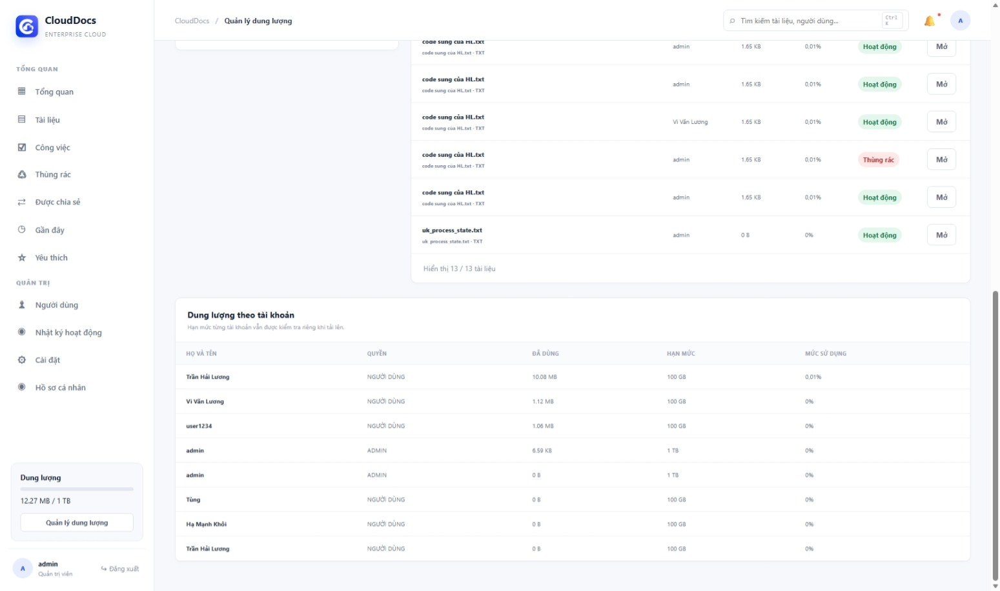

### K11. Nhật ký hoạt động

Mở Nhật ký hoạt động. Ảnh ghi nhận người thực hiện và thời điểm tải lên, xóa, khôi phục, nộp báo cáo và duyệt; có thể đối chiếu với các thao tác K04–K08.

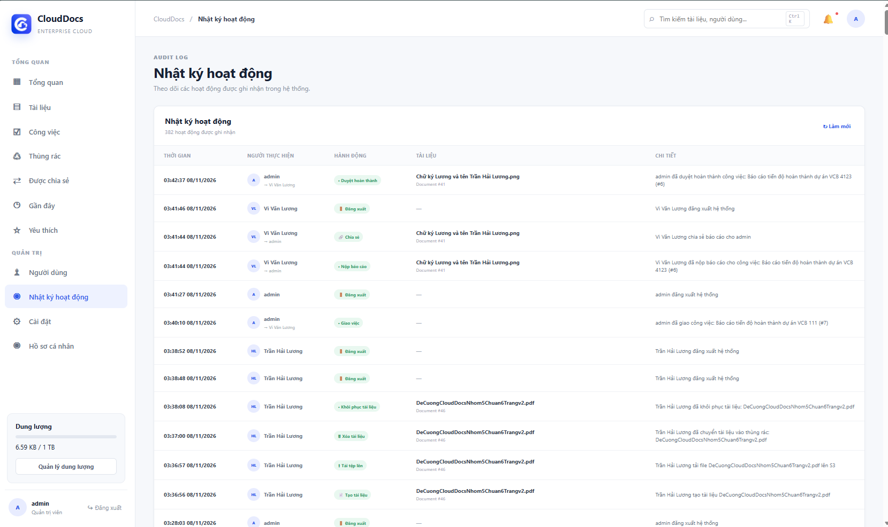

### K12. Tìm kiếm tài liệu

Nhập DeCuong trong ô tìm tài liệu. Hai kết quả có tên phù hợp được hiển thị; ảnh chứng minh kết quả tìm kiếm theo tên, chưa minh họa lọc theo loại hoặc phòng ban.

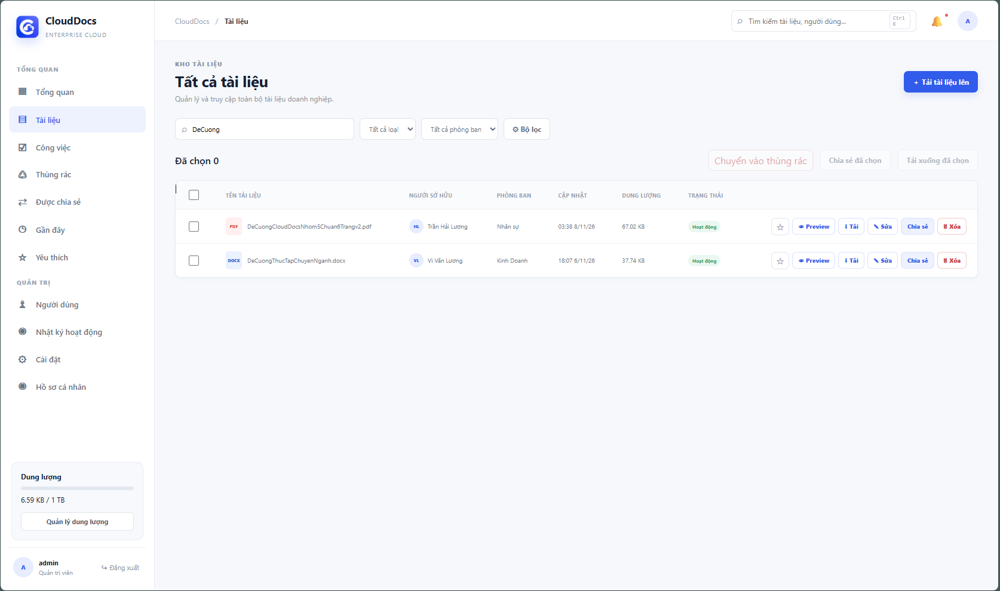

### K13. Quản lý phòng ban

Trong phiên admin, mở Phòng ban. Ảnh hiển thị bốn phòng ban admin, Kinh Doanh, Kỹ thuật và Nhân sự ở trạng thái Đang sử dụng, hình thức gán là Admin gán. Giao diện có ô thêm phòng ban, lựa chọn Cho nhân viên tự chọn và các nút Sửa, Ngừng sử dụng, Xóa. Đây là minh chứng danh sách và các thao tác được cung cấp; ảnh chưa ghi nhận kết quả thực hiện từng thao tác.

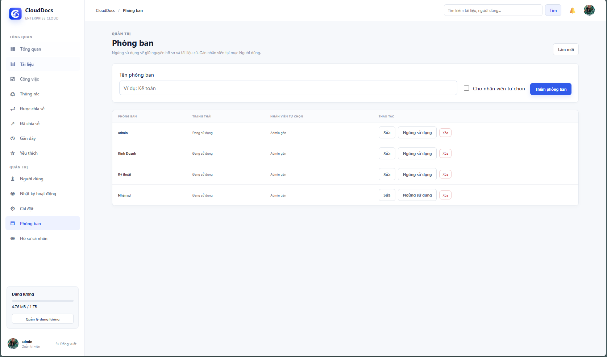

### K14. Tài liệu trong thư mục

Mở thư mục 123 trong mục Tài liệu. Đường dẫn Tài liệu → 123 và ba tệp bên trong được hiển thị, cùng nút tạo thư mục, chuyển vào thư mục và các thao tác theo tệp. Thanh phân trang ghi 1–3 / 3 mục ở trang 1. Ảnh minh họa việc duyệt thư mục và giao diện phân trang; chưa chứng minh chuyển trang với hơn 20 mục hoặc di chuyển tệp thành công. Các tệp SQL trong danh sách là tài liệu được lưu trong ứng dụng, không chứng minh đã thực thi SQL hay reset database.

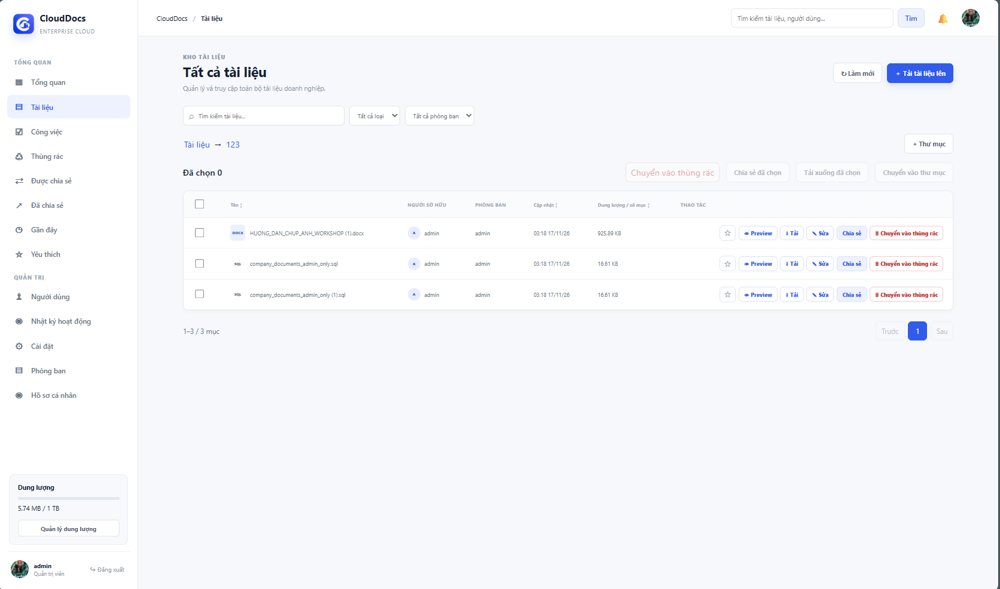

### K15. Theo dõi quyền tại Đã chia sẻ

Mở Đã chia sẻ bằng admin. Thống kê hiển thị 4 tài liệu, 2 người nhận và 4 quyền đang cấp. Các dòng ghi người nhận, phòng ban Nhân sự, thời điểm chia sẻ và quyền Xem hoặc Chỉnh sửa; mỗi dòng có bộ chọn quyền và nút Thu hồi. Giao diện còn hỗ trợ chọn nhiều quyền để thu hồi. Ảnh minh họa quyền đang được liệt kê; cần đối chiếu sau thao tác và bằng tài khoản người nhận để xác nhận đổi/thu hồi quyền có hiệu lực.

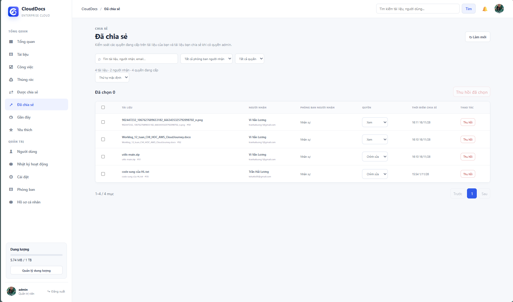

### K16. Hộp chỉnh sửa và ghi đè nội dung

Tại cùng thư mục 123 ở K14, mở Sửa đối với HUONG_DAN_CHUP_ANH_WORKSHOP (1).docx, Document #57. Hộp thoại cho phép sửa tên, phòng ban, mô tả, trạng thái và chọn tệp thay thế tùy chọn tại vùng Ghi đè nội dung tệp. Hướng dẫn trên giao diện nêu giới hạn 100 MB và không cho ghi đè báo cáo đang chờ duyệt hoặc đã hoàn thành. Ảnh chưa có tệp thay thế được chọn hoặc thông báo lưu thành công, vì vậy chỉ ghi nhận giao diện chuẩn bị chỉnh sửa.

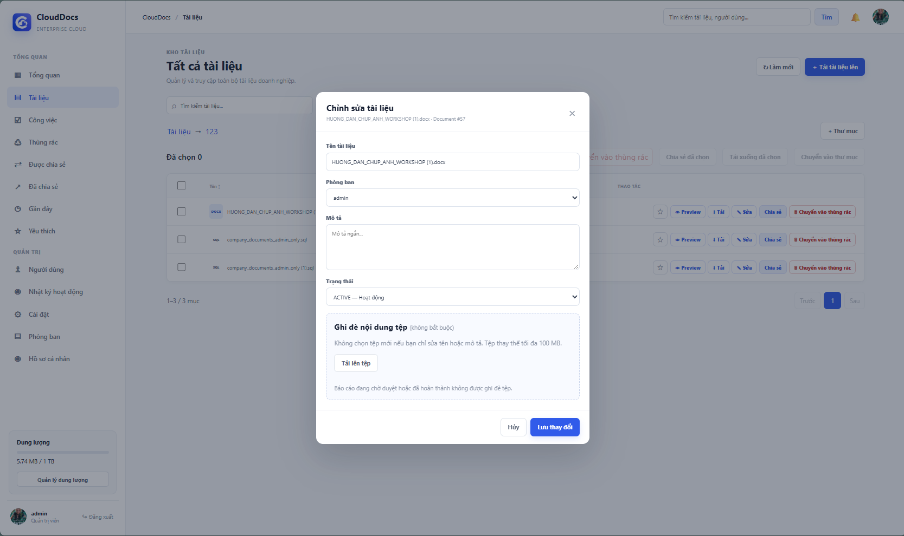

### K17. Hồ sơ cá nhân và avatar

Mở Hồ sơ cá nhân. Ảnh hiển thị avatar, các nút Chọn ảnh/Lưu ảnh/Xóa ảnh, tên đăng nhập nội bộ cố định và các trường họ tên, email, phòng ban. Phần thông tin quyền ghi ADMIN, trạng thái Đang hoạt động. Giao diện hướng dẫn dùng JPG/PNG tối đa 5 MB và cắt vuông ở giữa. Ảnh minh họa hồ sơ hiện có và các lựa chọn cập nhật; chưa có cặp ảnh trước/sau hoặc thông báo xác nhận lưu thay đổi.

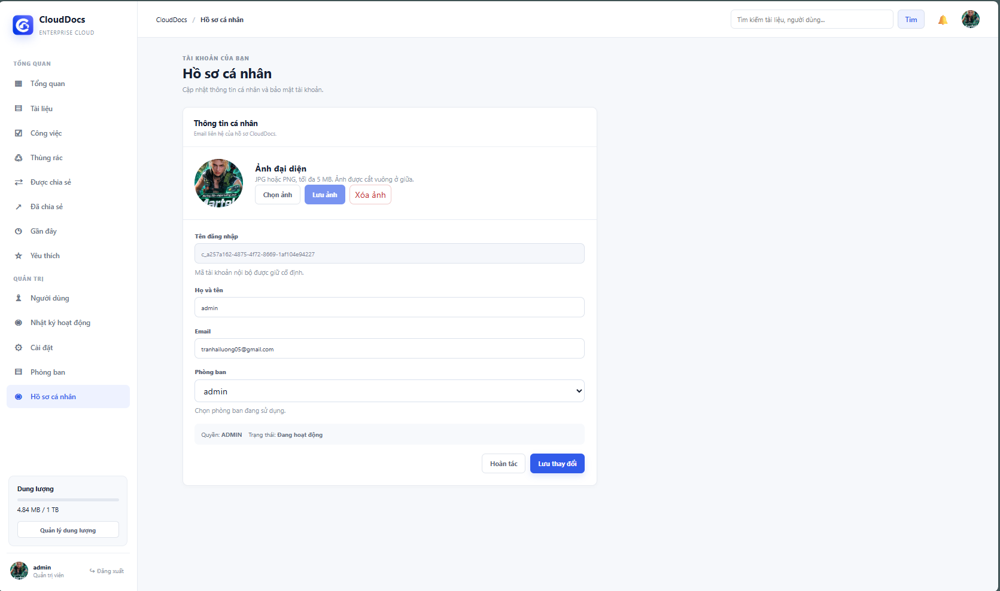

### K18. Tổng hợp trạng thái công việc và nộp muộn

Mở Công việc, chọn phạm vi Đã giao. Ảnh ghi nhận 4 công việc, 1 Chờ duyệt và 0 Quá hạn; các dòng lần lượt có trạng thái Chưa bắt đầu, Đang thực hiện, Chờ duyệt và Hoàn thành. Công việc VCB ở dòng cuối có thêm nhãn Nộp muộn, minh họa việc hiển thị đồng thời trạng thái hoàn thành và dấu hiệu nộp trễ. Đây là danh sách các công việc khác nhau, không phải chuỗi chuyển trạng thái của cùng một công việc; cần ảnh chi tiết hạn nộp/thời gian nộp để kiểm chứng cách xác định nộp muộn.

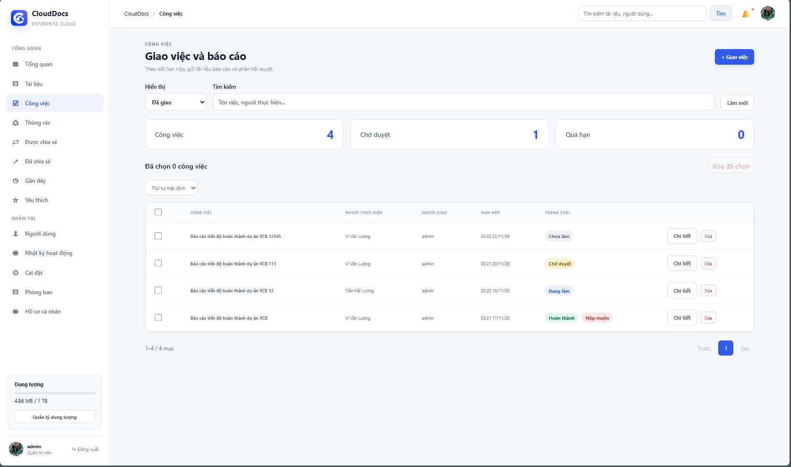
