## Điều kiện kiểm thử

Ít nhất một ADMIN, hai USER đang hoạt động đã liên kết Cognito; tệp nhỏ được phép dùng, một file rỗng và một file quá giới hạn để thử từ chối. Dùng dữ liệu thử, ghi commit, môi trường, người chạy và thời điểm. Bảng sau là **kịch bản/kết quả mong đợi**, không phải bảng PASS sẵn.

| Mã | Kịch bản | Kết quả mong đợi |
| --- | --- | --- |
| AUTH-01 | Không gửi/sai/hết hạn access token | API nghiệp vụ từ chối, không lộ nội dung |
| AUTH-02 | USER gọi API quản trị | Bị từ chối |
| DOC-01 | Tạo metadata, PUT S3, xác nhận upload | Object tồn tại, metadata đúng và đọc lại được |
| DOC-02 | Upload trùng tên cùng lúc | Object key khác nhau, không ghi đè nhầm |
| DOC-03 | Upload lỗi hoặc chưa PUT, gọi confirm | Không xác nhận object thiếu; allocation được theo dõi |
| DOC-04 | File 0 byte | Preview/download xử lý hợp lệ theo định dạng |
| DOC-05 | File >100 MiB hoặc vượt quota | Bị từ chối; kiểm tra cấp phát không vượt hạn mức |
| ACL-01 | Chia sẻ VIEW cho USER B | B xem trước được, không được cấp download/edit |
| ACL-02 | Chia sẻ DOWNLOAD/EDIT | Cho phép đúng thao tác; không tự có quyền quản lý chia sẻ |
| ACL-03 | USER C không được chia sẻ | Không xem/tải/sửa được qua API |
| ACL-04 | Thu hồi quyền B | Yêu cầu cấp URL mới bị chặn; ghi nhận URL cũ còn hiệu lực tới expiry |
| TRASH-01 | Chủ sở hữu đưa file vào thùng rác | Chặn preview/download/edit/share, vẫn tính quota |
| TRASH-02 | Khôi phục | Trở về ACTIVE và giữ quyền chia sẻ cũ theo thiết kế |
| TRASH-03 | Xóa vĩnh viễn tệp thử | Xóa object/quyền, metadata PURGED size 0, giữ audit |
| BULK-01 | Chọn nhiều file có một lỗi quyền | Hiển thị thành công/thất bại từng file; xử lý lại phần lỗi |
| QUOTA-01 | Pending + trash + tài liệu được chia sẻ | Pending/trash tính cho chủ; chia sẻ không nhân dung lượng |
| AUDIT-01 | USER/ADMIN đọc nhật ký | USER chỉ audit do mình thực hiện; ADMIN xem toàn hệ thống |
| TASK-01 | ADMIN giao việc, USER nộp tài liệu hợp lệ | Thông báo riêng, trạng thái SUBMITTED/chờ duyệt |
| TASK-02 | Người giao yêu cầu sửa rồi duyệt | Đúng người có quyền; lưu feedback, audit và thông báo |
| TASK-03 | Nộp sau hạn | Được nộp và có nhãn nộp muộn; chờ duyệt không bị tính quá hạn do người duyệt chậm |
| TASK-04 | Hai tab dùng version cũ | Từ chối 409, yêu cầu tải lại dữ liệu |
| TASK-05 | Xóa/ghi đè file đang là báo cáo SUBMITTED/COMPLETED | API chặn theo guard của phiên bản hiện tại |
| TASK-06 | Xóa một/nhiều công việc | Chỉ ADMIN người giao; giữ tài liệu/quyền/audit, thông báo liên quan được xử lý |
| USER-01 | Xóa tài khoản còn tệp hoặc công việc chưa xong | Bị chặn theo điều kiện hiện hành |

## Kiểm thử tự động và giới hạn

Trong repository CloudDocs: mvn -f Back_end/pom.xml test; node --test FrontEnd/tests/*.test.cjs. Kiểm thử dùng mock repository/AWS client không xác nhận migration RDS, khóa dòng, redirect Cognito, CORS S3 hay PDF trong trình duyệt. Kết quả được ghi nhận theo từng lần chạy kiểm thử.

<!-- workshop-evidence -->

## Thực hành và kết quả minh họa

### K01. Giao diện sau đăng nhập

Sau khi đăng nhập, trang Tổng quan hiển thị tài khoản admin và menu ứng dụng. Ảnh minh họa phiên đã vào CloudDocs; cấu hình xác thực được đối chiếu tại mục Cognito.

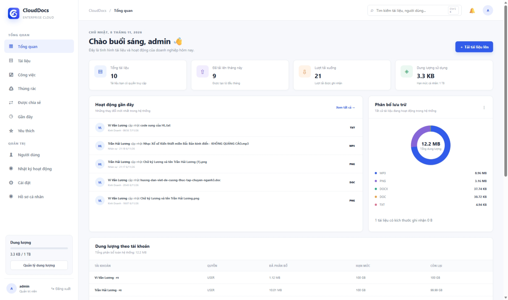

### K02a. Tải tài liệu lên

Chọn Tải tài liệu lên, gửi tệp thử và kiểm tra danh sách sau khi lưu. Ảnh có thông báo một tài liệu đã được lưu thành công.

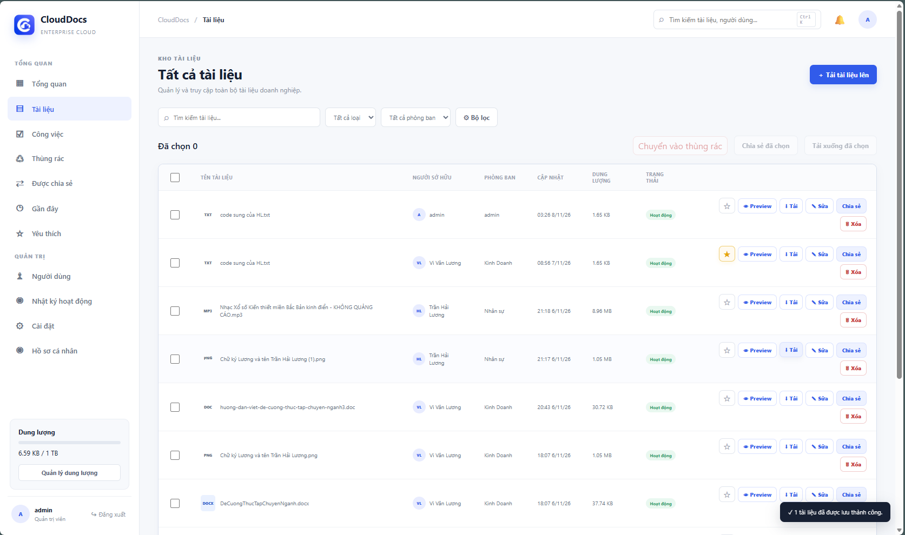

### K02b. Xem trước nội dung

Chọn Preview trên tệp TXT. Nội dung tệp thử hiển thị trong hộp xem trước của ứng dụng.

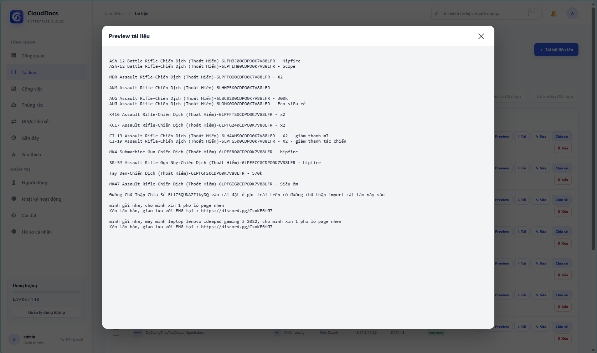

### K02c. Tải xuống

Chọn Tải và kiểm tra danh sách tải của trình duyệt. Tệp TXT đã tải xuất hiện cùng thông báo tải xuống của CloudDocs.

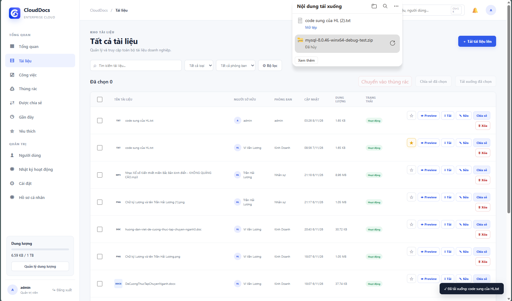

### K03. Tài liệu được chia sẻ

Đăng nhập bằng tài khoản nhân viên, mở Được chia sẻ. Các dòng hiển thị bộ nút khác nhau: chỉ Preview hoặc thêm Tải/Sửa, minh họa quyền tại giao diện; kiểm thử từ chối API được thực hiện theo bảng kịch bản bên trên.

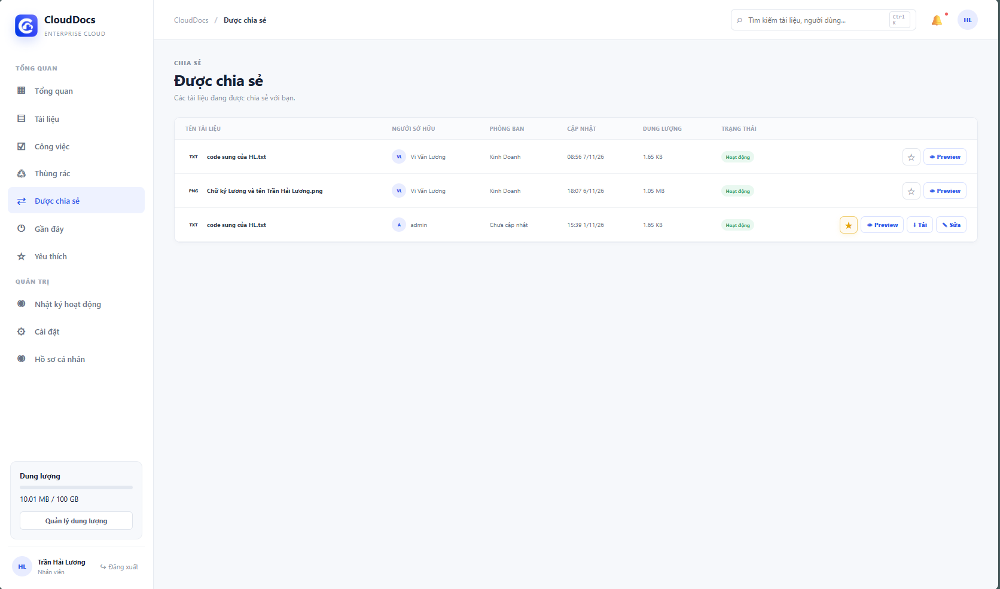

### K04. Tài liệu trong thùng rác

Xóa mềm tệp PDF và mở Thùng rác. Ảnh hiển thị tài liệu, thời điểm xóa cùng nút Khôi phục và Xóa vĩnh viễn.

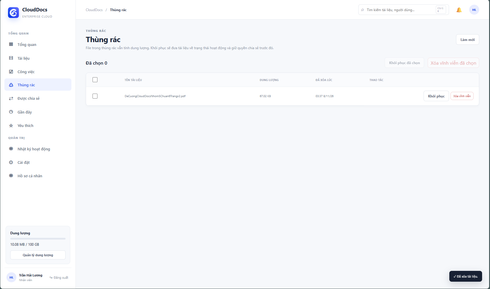

### K05. Khôi phục tài liệu

Khôi phục tệp ở K04 rồi quay lại Tài liệu. Cùng tệp PDF xuất hiện ở trạng thái Hoạt động, kèm thông báo khôi phục 1/1 thành công.

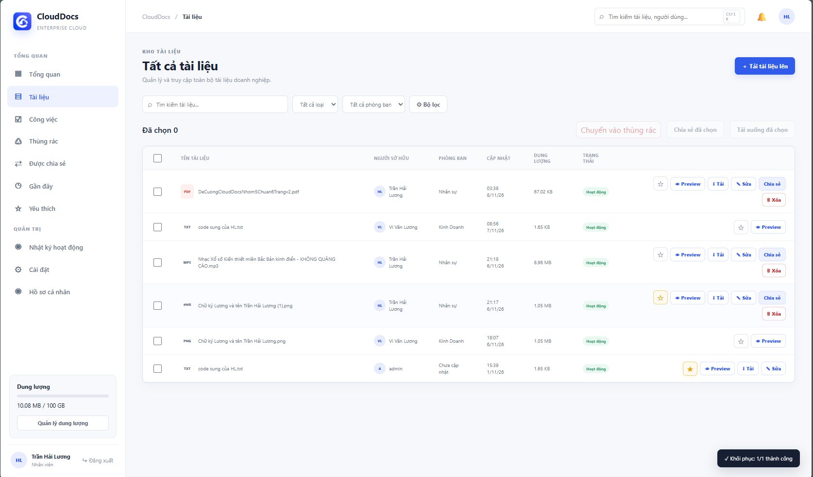

### K06. Chi tiết công việc được giao

Mở chi tiết công việc để xem người thực hiện, người giao, hạn nộp và yêu cầu. K06 là công việc VCB 111 với dữ liệu thử; đây là ví dụ tạo việc riêng, không phải công việc VCB 4123 ở cặp K07–K08.

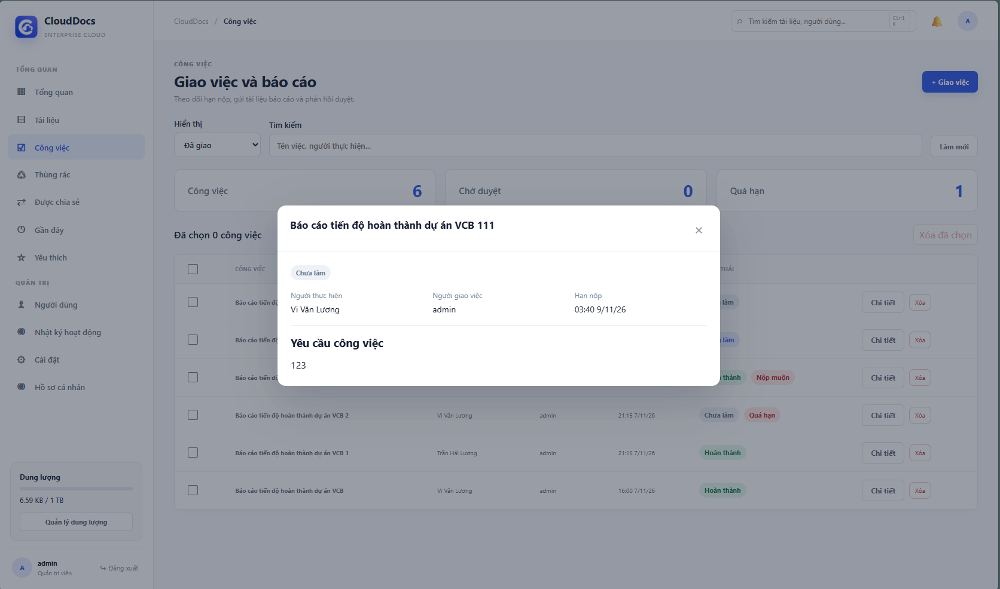

### K07. Báo cáo chờ duyệt

Sau khi nhân viên nộp tệp thử cho VCB 4123, quản trị viên mở chi tiết để xem trạng thái Chờ duyệt, tệp đính kèm, thời gian nộp và các nút phản hồi.

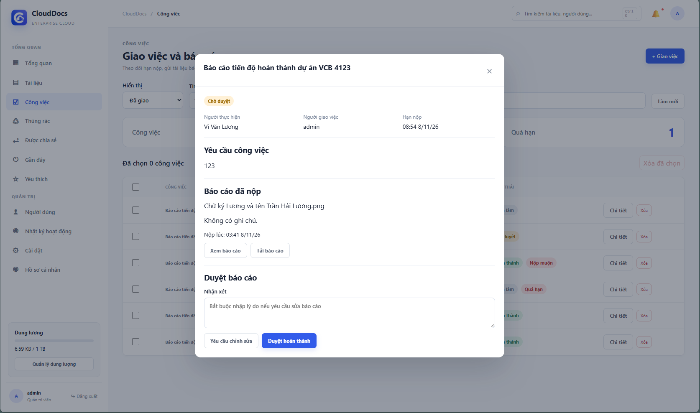

### K08. Kết quả duyệt báo cáo

Duyệt hoàn thành chính công việc ở K07. Trạng thái chuyển sang Hoàn thành và thông báo xác nhận xuất hiện; cặp ảnh minh họa chuyển trạng thái nộp → duyệt.

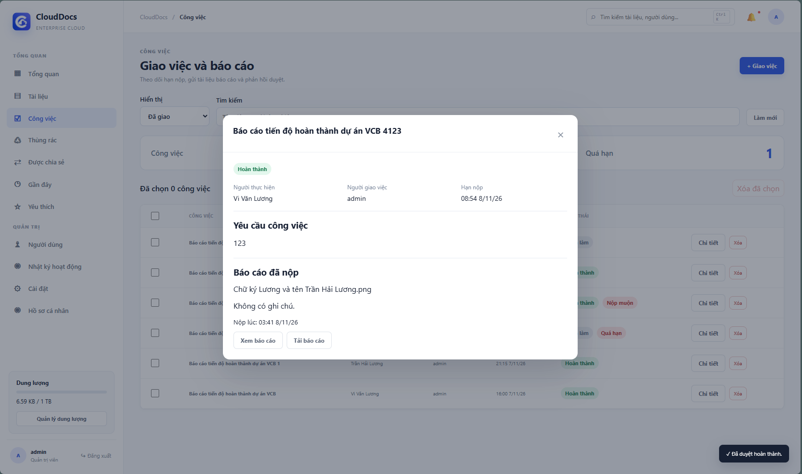

### K09. Quản lý người dùng

Đăng nhập admin, mở Người dùng để đối chiếu danh sách tài khoản, phòng ban, role và trạng thái. Các lựa chọn thay đổi quyền/trạng thái hiển thị tại từng dòng.

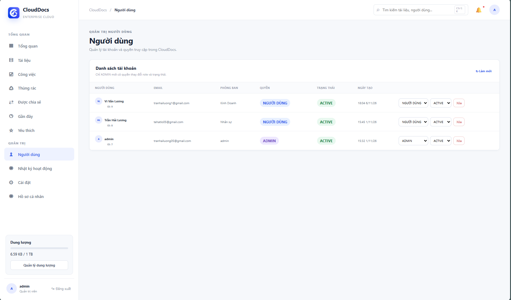

### K10a. Tổng quan quản lý dung lượng

Đăng nhập admin và mở Quản lý dung lượng. Ảnh ghi nhận tổng đã dùng 12.27 MB trên hạn mức hiển thị 1 TB, dung lượng trong thùng rác 1.65 KB, biểu đồ phân bố theo loại và danh sách tài liệu sắp xếp theo dung lượng. Đây là thống kê của ứng dụng tại thời điểm chụp, không phải hạn mức dịch vụ Amazon S3.

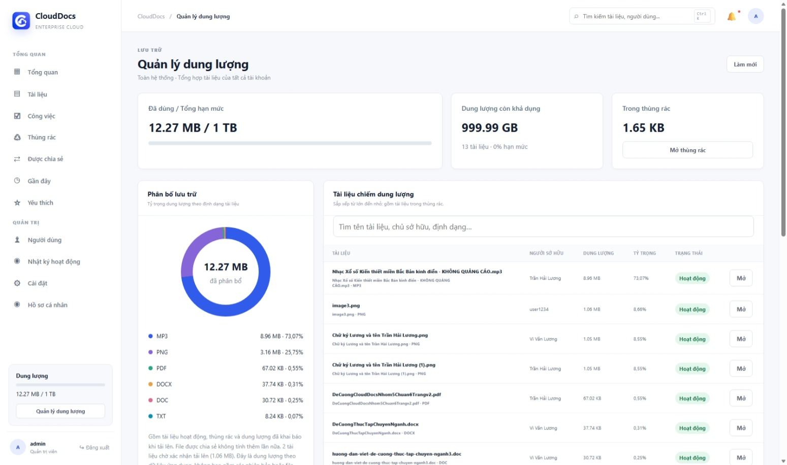

### K10b. Dung lượng theo tài khoản

Cuộn xuống bảng Dung lượng theo tài khoản để đối chiếu họ tên, quyền, đã dùng, hạn mức và mức sử dụng. Ảnh hiển thị hạn mức 100 GB cho người dùng và 1 TB cho admin; tài liệu trong thùng rác vẫn có mặt trong danh sách phân bổ phía trên.

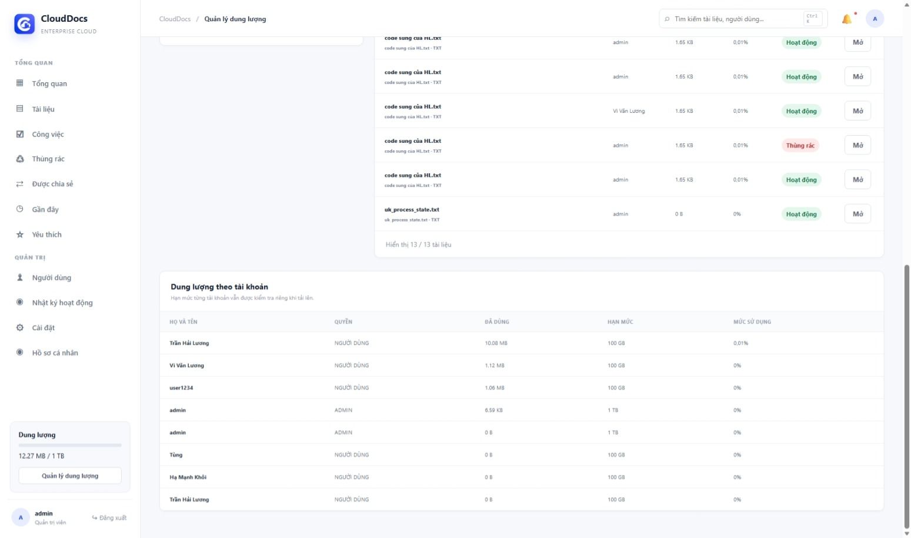

### K11. Nhật ký hoạt động

Mở Nhật ký hoạt động. Ảnh ghi nhận người thực hiện và thời điểm tải lên, xóa, khôi phục, nộp báo cáo và duyệt; có thể đối chiếu với các thao tác K04–K08.

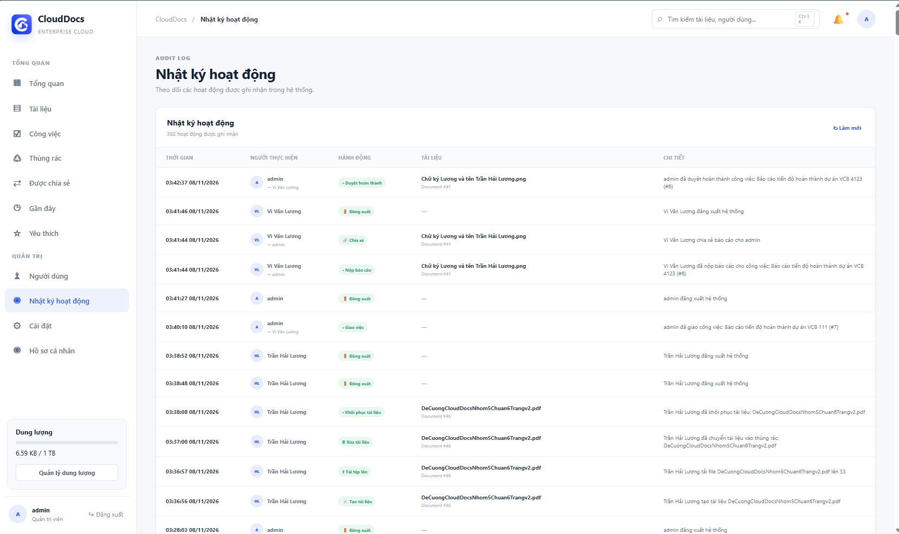

### K12. Tìm kiếm tài liệu

Nhập DeCuong trong ô tìm tài liệu. Hai kết quả có tên phù hợp được hiển thị; ảnh chứng minh kết quả tìm kiếm theo tên, chưa minh họa lọc theo loại hoặc phòng ban.

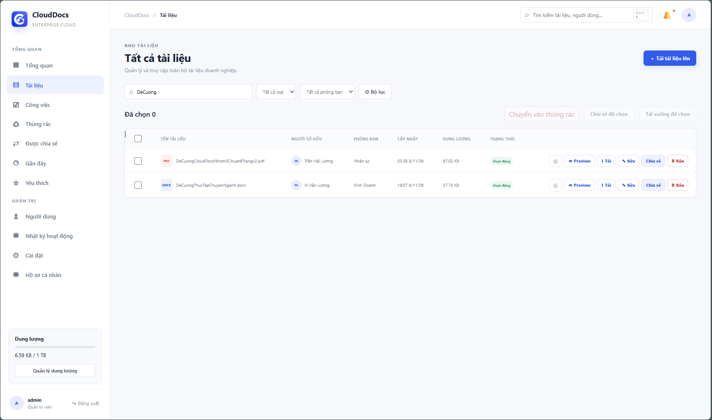
